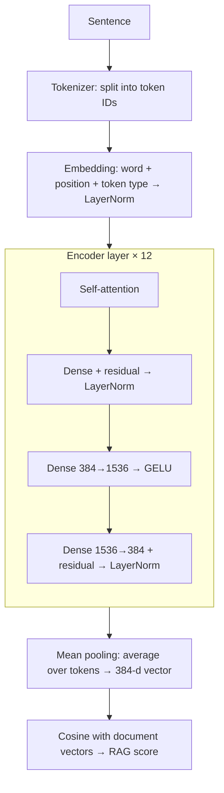

# Chapter 1 — Overview

← [[00 - Index]] | Next: [[02 - Fixed-point numbers and Q format]] →

## 1.1. The problem

The project builds a RAG (Retrieval-Augmented Generation) system whose search stage runs on an
FPGA. Every sentence is turned into a **384-dimensional vector** (sentence embedding). The closer
two sentences are in meaning, the closer the cosine between their vectors is to 1. When a user
asks a question, the system embeds the question and compares it with the embeddings of the
document passages to retrieve the most relevant ones.

The model is **MiniLM** (`paraphrase-multilingual-MiniLM-L12-v2`), a small transformer:

| Parameter | Value |
|---|---|
| Encoder layers | 12 |
| Hidden size $N$ | 384 |
| Attention heads $H$ | 12, each $D = 32$ dimensions |
| FFN intermediate size $F$ | 1536 |
| Vocabulary | 250 037 tokens |
| Max tokens per sentence | 512 (the project uses at most 128) |

## 1.2. The MiniLM pipeline

The tokenizer runs in software (the KV260's ARM CPU). Everything from the embedding to the
cosine is the part to accelerate.

## 1.3. Why integers

The original model uses 32-bit floating point (float32). On an FPGA, floating point is expensive:
a float adder or multiplier takes many LUTs and DSPs and runs slower, and operations like `exp`,
`sqrt` and division cost even more. Meanwhile the DSP48E2 block of a Xilinx FPGA does a
**27 × 18-bit integer multiply and a 48-bit accumulate** in one cycle.

So the project moves every computation to integers:

- **At run time only:** integer add, subtract, multiply, bit shifts, comparisons, table lookups (LUT/ROM).
- **Never:** division, square root, `exp`, `erf`, floating point.

## 1.4. Offline versus run time

Every "hard" operation is split into two parts:

| Part | Where | Allowed |
|---|---|---|
| **Offline** (preparation) | PC, once | Anything, including floats: weight quantization, constants, lookup tables |
| **Run time** | FPGA, per sentence | Integer operations only |

Example: GELU needs `erf`. Offline we precompute a 1024-entry table of $\Phi(x)$. At run time the
FPGA only looks up the table and multiplies.

## 1.5. The golden model

Before writing RTL, the project writes a **NumPy model** that performs exactly the integer
operations the hardware will. It serves three purposes:

1. **Measure accuracy** against PyTorch float32 before spending effort on hardware.
2. **Fix the bit width** of every register: the model raises an error as soon as a value does not fit.
3. **Provide expected results for the RTL testbenches**: the RTL must match the NumPy model
   **bit for bit**.

To keep the NumPy model close to the hardware, every number is a data type with a fixed bit width,
described in [[03 - Hardware data type Fixed]] and [[04 - Scale m·2^-n]].

## 1.6. Summary of results

Compared with PyTorch float32 (details in [[15 - Verification and accuracy]]):

| Quantity | Result |
|---|---|
| Cosine between NumPy and PyTorch embeddings | 0.9985 – 0.9997 |
| Largest RAG score error | 0.012 |
| Top 3 search results | Identical to PyTorch |

---

← [[00 - Index]] | Next: [[02 - Fixed-point numbers and Q format]] →
