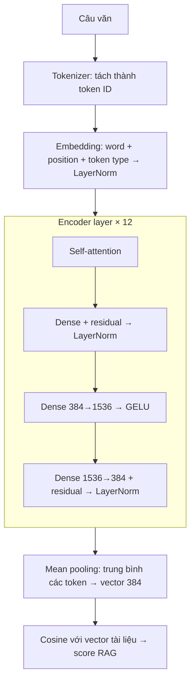

# Chương 1 — Tổng quan

← [[00 - Mục lục]] | Tiếp: [[02 - Số fixed-point và định dạng Q]] →

## 1.1. Bài toán

Đồ án xây dựng một hệ thống RAG (Retrieval-Augmented Generation) có phần tìm kiếm chạy trên
FPGA. Mỗi câu văn được biến thành một **vector 384 chiều** (sentence embedding). Hai câu càng
giống nghĩa thì cosine giữa hai vector càng gần 1. Khi người dùng hỏi, hệ thống tính embedding
của câu hỏi rồi so với embedding của các đoạn tài liệu để lấy ra những đoạn liên quan nhất.

Mô hình dùng là **MiniLM** (`paraphrase-multilingual-MiniLM-L12-v2`), một transformer nhỏ:

| Thông số | Giá trị |
|---|---|
| Số lớp encoder | 12 |
| Hidden size $N$ | 384 |
| Số head attention $H$ | 12, mỗi head $D = 32$ chiều |
| FFN trung gian $F$ | 1536 |
| Từ vựng | 250 037 token |
| Số token tối đa của một câu | 512 (đồ án dùng tối đa 128) |

## 1.2. Pipeline của MiniLM

Tokenizer chạy trên phần mềm (CPU ARM của KV260). Mọi bước từ embedding đến cosine là phần
cần tăng tốc.

## 1.3. Vì sao phải dùng số nguyên

Mô hình gốc dùng số thực 32 bit (float32). Trên FPGA, số thực rất tốn tài nguyên: một bộ
cộng/nhân float chiếm nhiều LUT và DSP, chạy chậm hơn, và các phép như `exp`, `sqrt`, chia
còn tốn hơn nữa. Trong khi đó, khối DSP48E2 của FPGA Xilinx làm **phép nhân số nguyên
27 × 18 bit và cộng dồn 48 bit** trong một chu kỳ.

Vì vậy đồ án đổi toàn bộ phép tính sang số nguyên:

- **Lúc chạy chỉ dùng:** cộng, trừ, nhân số nguyên, dịch bit, so sánh, tra bảng (LUT/ROM).
- **Không dùng:** chia, căn, `exp`, `erf`, số thực.

## 1.4. Offline và lúc chạy

Mỗi phép "khó" được tách làm hai phần:

| Phần | Làm ở đâu | Được dùng gì |
|---|---|---|
| **Offline** (chuẩn bị) | Máy tính, một lần | Mọi thứ, kể cả số thực: lượng tử hoá weight, tính hằng số, tạo bảng tra |
| **Lúc chạy** | FPGA, mỗi câu | Chỉ phép số nguyên |

Ví dụ: hàm GELU cần `erf`. Offline, ta tính sẵn bảng 1024 giá trị của $\Phi(x)$. Lúc chạy, FPGA
chỉ tra bảng rồi nhân.

## 1.5. Mô hình tham chiếu (golden model)

Trước khi viết RTL, đồ án viết một **mô hình NumPy** làm đúng từng phép số nguyên mà phần cứng
sẽ làm. Mô hình này phục vụ ba việc:

1. **Đo độ chính xác** so với PyTorch float32 trước khi tốn công viết phần cứng.
2. **Chốt độ rộng bit** của từng thanh ghi: mô hình báo lỗi ngay nếu một giá trị không vừa.
3. **Làm đáp án cho testbench RTL**: RTL phải cho ra **giống từng bit** với mô hình NumPy.

Để mô hình NumPy bám sát phần cứng, mọi số đều là một kiểu dữ liệu có độ rộng bit cố định,
được trình bày ở [[03 - Kiểu dữ liệu phần cứng Fixed]] và [[04 - Scale m·2^-n]].

## 1.6. Kết quả tóm tắt

So với PyTorch float32 (chi tiết ở [[15 - Kiểm chứng và độ chính xác]]):

| Đại lượng | Kết quả |
|---|---|
| Cosine giữa embedding NumPy và PyTorch | 0.9985 – 0.9997 |
| Sai số score RAG lớn nhất | 0.012 |
| Top 3 kết quả tìm kiếm | Giống hệt PyTorch |

---

← [[00 - Mục lục]] | Tiếp: [[02 - Số fixed-point và định dạng Q]] →
