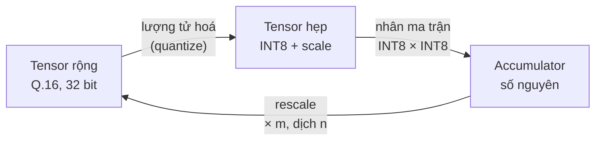

# Chương 5 — Cách lưu số

← [[04 - Scale m·2^-n]] | Tiếp: [[06 - Lượng tử hoá]] →

## 5.1. Hai loại tensor

Mô hình chỉ dùng hai cách lưu số:

| Loại | Định dạng | Dùng cho |
|---|---|---|
| **Rộng** | `Q16`: có dấu 32 bit, 16 bit thập phân | Residual stream, đầu ra `Linear`, LayerNorm, GELU, pooling, bias, beta |
| **Hẹp** | `QTensor`: mã INT8 $[-127, 127]$ + `Scale` $m \cdot 2^{-n}$ | **Chỉ** làm đầu vào của phép nhân ma trận |

**Tensor rộng** dùng chung một đơn vị $2^{-16}$, nên cộng residual chỉ là phép cộng số nguyên,
không cần căn chỉnh scale. Q.16 trong 32 bit đủ chứa mọi activation của MiniLM (cỡ vài chục đến
vài trăm) mà vẫn chính xác tới $1.5 \times 10^{-5}$.

**Tensor hẹp** chỉ tồn tại ngay trước phép nhân ma trận. Lý do: systolic array làm phép nhân
INT8 × INT8 rất rẻ (một DSP có thể làm 2 phép như vậy), còn nhân 32 × 32 bit thì tốn nhiều DSP.
Ngay sau phép nhân, kết quả được đổi lại về Q.16.

## 5.2. Trọng số và hằng số (tính offline)

| Dữ liệu | Lưu dưới dạng | Scale |
|---|---|---|
| Weight `Linear` $(K, \text{out})$ | INT8 | một scale cho mỗi **cột** (kênh ra), shape $(1, \text{out})$ |
| Bảng embedding (word, position, token type) | INT8 | một scale cho mỗi **hàng** (token), shape $(V, 1)$ |
| Bias `Linear` | Q.16, 32 bit | — |
| LayerNorm $\gamma$ | $G = \gamma \sqrt{384}$ ở Q.10, 18 bit | — |
| LayerNorm $\beta$ | Q.16, 32 bit | — |
| $1/\sqrt{32}$ (attention) | `Scale.const(5793, 15)` | — |
| $\log_2 e$ (softmax) | 47 274 ở Q.15 | — |
| Các bảng tra (exp2, GELU, rsqrt, nghịch đảo, $1/m$) | `Fixed` không dấu | — |

Chi tiết các bảng tra ở [[14 - Độ rộng bit và đưa lên FPGA]].

## 5.3. Mỗi scale lưu thế nào

Một scale là **hai số nguyên riêng biệt** $m$ (7 bit) và $n$ (5 bit), không gộp thành một số
thực. Trong NumPy, chúng là hai mảng `Fixed` có shape để broadcast thẳng với tensor:

| Tensor | Shape của mã | Shape của $m$, $n$ |
|---|---|---|
| Weight `Linear` $(384, 1536)$ | $(384, 1536)$ | $(1, 1536)$ |
| Bảng word embedding | $(250\,037, 384)$ | $(250\,037, 1)$ |
| Đầu vào `Linear` lúc chạy $(B, L, 384)$ | $(B, L, 384)$ | $(B, L, 1)$ |

Scale của weight được tính offline và lưu cùng weight. Scale của activation **không lưu**: mỗi
lần chạy, nó được tính lại từ dữ liệu (xem [[06 - Lượng tử hoá#6.3. Activation (lúc chạy)]]).

Ma trận scale đầy đủ (ví dụ $7 \times 384$ cho một phép `Linear`) không bao giờ được lưu; nó chỉ
xuất hiện qua broadcast lúc tính.

Khi đưa lên phần cứng, $m$ và $n$ có thể ghép vào một word 12 bit bằng `Scale.pack()`.

## 5.4. Bias lưu ở Q.16

Cách lượng tử hoá INT8 thông thường (TFLite, PyTorch) lưu bias thành INT32 theo scale của
accumulator: $b_{int32} = \operatorname{round}(b / (S_x S_w))$, rồi cộng thẳng vào accumulator.
Cách đó cần biết trước $S_x$.

Ở đây $S_x$ được tính **lúc chạy cho từng token**, mỗi token một giá trị khác nhau. Nếu dùng
cách thông thường thì mỗi token cần một bản bias riêng, không tính trước được.

Vì vậy bias được lưu ở **Q.16** (mỗi kênh một giá trị, 18 bit là đủ với MiniLM) và được cộng
**sau** khi kết quả nhân ma trận đã về Q.16:

$$
y_{q16} = \operatorname{round\_shift}\!\big(\mathrm{acc} \cdot m_x m_w,\ n_x + n_w - 16\big) + b_{q16}
$$

Đổi lại, bias chỉ chính xác tới $2^{-16}$, và phần cứng cần bộ cộng đặt sau bộ dịch.

## 5.5. Ranh giới với phần mềm

Bên trong mô hình, mọi thứ là `Fixed`. Ở rìa ngoài:

- Mô hình trả về **mảng `np.int32` thô** ở Q.16, shape $(B, 384)$ — đúng dạng FPGA gửi về CPU.
- Hàm cosine nhận mảng Q.16 và trả về **`np.int32` thô ở Q.15**.

---

← [[04 - Scale m·2^-n]] | Tiếp: [[06 - Lượng tử hoá]] →
