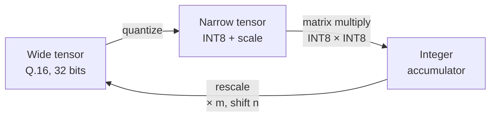

# Chapter 5 — Number storage

← [[04 - Scale m·2^-n]] | Next: [[06 - Quantization]] →

## 5.1. Two kinds of tensor

The model stores numbers in only two ways:

| Kind | Format | Used for |
| --- | --- | --- |
| **Wide** | `Q16`: signed 32 bits, 16 fraction bits | Residual stream, `Linear` outputs, LayerNorm, GELU, pooling, bias, beta |
| **Narrow** | `QTensor`: INT8 codes $[-127, 127]$ + `Scale` $m \cdot 2^{-n}$ | **Only** as inputs to matrix multiplies |

**Wide tensors** share one unit, $2^{-16}$, so a residual addition is a plain integer addition
with no scale alignment. Q.16 in 32 bits holds every MiniLM activation (tens to hundreds) while
staying precise to $1.5 \times 10^{-5}$.

**Narrow tensors** exist only right before a matrix multiply. The reason: a systolic array does
INT8 × INT8 multiplies very cheaply (one DSP can do two of them), while 32 × 32-bit multiplies
cost many DSPs. Right after the multiply, the result is converted back to Q.16.

## 5.2. Weights and constants (computed offline)

| Data | Stored as | Scale |
| --- | --- | --- |
| `Linear` weight $(K, \text{out})$ | INT8 | one scale per **column** (output channel), shape $(1, \text{out})$ |
| Embedding tables (word, position, token type) | INT8 | one scale per **row** (token), shape $(V, 1)$ |
| `Linear` bias | Q.16, 32 bits | — |
| LayerNorm $\gamma$ | $G = \gamma \sqrt{384}$ in Q.10, 18 bits | — |
| LayerNorm $\beta$ | Q.16, 32 bits | — |
| $1/\sqrt{32}$ (attention) | `Scale.const(5793, 15)` | — |
| $\log_2 e$ (softmax) | 47 274 in Q.15 | — |
| Lookup tables (exp2, GELU, rsqrt, reciprocal, $1/m$) | unsigned `Fixed` | — |

Lookup table details are in [[14 - Bit widths and FPGA mapping]].

## 5.3. How each scale is stored

A scale is **two separate integers**, $m$ (7 bits) and $n$ (5 bits), not merged into a real
number. In NumPy they are two `Fixed` arrays whose shape broadcasts directly against the tensor:

| Tensor | Code shape | Shape of $m$, $n$ |
| --- | --- | --- |
| `Linear` weight $(384, 1536)$ | $(384, 1536)$ | $(1, 1536)$ |
| Word embedding table | $(250\,037, 384)$ | $(250\,037, 1)$ |
| `Linear` input at run time $(B, L, 384)$ | $(B, L, 384)$ | $(B, L, 1)$ |

Weight scales are computed offline and stored with the weights. Activation scales are **not
stored**: they are recomputed from the data on every run (see [[06 - Quantization#6.3. Activations (at run time)]]).

The full scale matrix (e.g. $7 \times 384$ for one `Linear`) is never stored; it only appears
through broadcasting during computation.

In hardware, $m$ and $n$ can be packed into one 12-bit word with `Scale.pack()`.

## 5.4. Bias is stored in Q.16

Common INT8 quantization (TFLite, PyTorch) stores the bias as INT32 at the accumulator scale,
$b_{int32} = \operatorname{round}(b / (S_x S_w))$, and adds it straight into the accumulator. That
requires $S_x$ to be known in advance.

Here $S_x$ is computed **at run time, per token**, with a different value for every token. With the
common approach each token would need its own copy of the bias, which cannot be precomputed.

So the bias is stored in **Q.16** (one value per channel; 18 bits suffice for MiniLM) and added
**after** the matrix-multiply result has been converted to Q.16:

$$
y_{q16} = \operatorname{round\_shift}\!\big(\mathrm{acc} \cdot m_x m_w,\ n_x + n_w - 16\big) + b_{q16}
$$

The trade-off: the bias is only precise to $2^{-16}$, and the hardware needs an adder after the shifter.

## 5.5. The boundary with software

Inside the model everything is `Fixed`. At the edges:

- The model returns a **raw `np.int32` array** in Q.16, shape $(B, 384)$, exactly what the FPGA
  sends back to the CPU.
- The cosine function takes Q.16 arrays and returns **raw `np.int32` in Q.15**.

---

← [[04 - Scale m·2^-n]] | Next: [[06 - Quantization]] →
