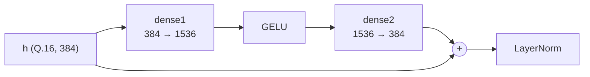

# Chapter 11 — GELU and residual

← [[10 - LayerNorm]] | Next: [[12 - Mean pooling and cosine]] →

Code: `model/numpy/utils/gelu.py`, `model/numpy/layers/feed_forward.py`,
`model/numpy/layers/attention_output.py`

## 11.1. The FFN block

Each encoder layer has a feed-forward block:



The two dense layers are `Linear` ([[07 - Linear]]) and LayerNorm is in [[10 - LayerNorm]]. This
chapter covers the remaining two parts: GELU and the residual addition.

## 11.2. GELU

### Original formula

$$
\operatorname{GELU}(x) = x \cdot \Phi(x), \qquad \Phi(x) = \tfrac{1}{2}\left(1 + \operatorname{erf}\!\left(\frac{x}{\sqrt{2}}\right)\right)
$$

$\Phi$ is the cumulative distribution function of the standard normal distribution. `erf` cannot
be computed with a few integer operations.

### Idea: look up $\Phi$, then multiply by $x$

$\Phi$ has two convenient properties:

- **Smooth**: a table with a small step is accurate enough.
- **Bounded in $[0, 1]$**: outside $[-8, 8)$, $\Phi$ is essentially 0 or 1.

So a single $\Phi$ table over $[-8, 8)$ with step $2^{-6}$ suffices: **1024 entries**, 16 bits each
in Q.15 (fits one BRAM18):

$$
\mathrm{PHI}[i] = \operatorname{round}\!\left(2^{15} \cdot \Phi\!\left(\frac{i - 512}{64}\right)\right), \qquad i = 0..1023
$$

### At run time

**Address:** convert $x$ (Q.16) to steps of $1/64$, add 512 to make the index non-negative, and
saturate to the table:

$$
\mathrm{idx} = \operatorname{clip}\!\Big(\operatorname{round\_shift}([x],\ 16 - 6) + 512,\ 0,\ 1023\Big)
$$

**Multiply by $x$:** $[x]$ is Q.16, $\mathrm{PHI}$ is Q.15, the product is Q.31; shift by 15 to get Q.16:

$$
[\operatorname{GELU}(x)] = \operatorname{round\_shift}\!\left([x] \cdot \mathrm{PHI}[\mathrm{idx}],\ 15\right)
$$

```python
address = (x.round_shift(x.frac - 6) + 512).clip(0, len(lut) - 1)
return (x * lut[address]).round_shift(lut.frac)
```

Outside $[-8, 8)$ the address is clamped to the first or last entry, i.e. $\Phi = 0$ (GELU = 0) or
$\Phi = 1$ (GELU = $x$). The result is still correct.

GELU takes **the Q.16 output of dense1 directly**, before any INT8 rounding, so no extra precision
is lost. The result is stored in a 32-bit Q.16 register. The largest absolute error measured on
$[-12, 12]$ is about $1.9 \times 10^{-3}$.

## 11.3. Residual addition

Both attention and FFN end with a residual addition:

$$
[h'] = [\operatorname{dense}(\cdot)] + [h]
$$

Both operands are **Q.16**, so this is a plain 32-bit integer addition producing 33 bits. No scale
alignment is needed. This is the main benefit of keeping all wide tensors in one format
([[05 - Number storage#5.1. Two kinds of tensor]]).

The 33-bit result goes straight into LayerNorm, which ignores the input scale and so accepts any width.

---

← [[10 - LayerNorm]] | Next: [[12 - Mean pooling and cosine]] →
