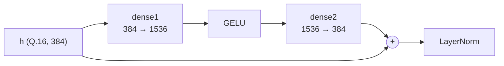

# Chương 11 — GELU và residual

← [[10 - LayerNorm]] | Tiếp: [[12 - Mean pooling và cosine]] →

Code: `model/numpy/utils/gelu.py`, `model/numpy/layers/feed_forward.py`,
`model/numpy/layers/attention_output.py`

## 11.1. Khối FFN

Mỗi encoder layer có một khối feed-forward:



Hai phép dense là `Linear` ([[07 - Linear]]), LayerNorm ở [[10 - LayerNorm]]. Chương này giải
thích hai phần còn lại: GELU và phép cộng residual.

## 11.2. GELU

### Công thức gốc

$$
\operatorname{GELU}(x) = x \cdot \Phi(x), \qquad \Phi(x) = \tfrac{1}{2}\left(1 + \operatorname{erf}\!\left(\frac{x}{\sqrt{2}}\right)\right)
$$

$\Phi$ là hàm phân phối tích luỹ của phân phối chuẩn. Hàm `erf` không tính được bằng vài phép
số nguyên.

### Ý tưởng: tra bảng $\Phi$, rồi nhân với $x$

$\Phi$ có hai tính chất thuận lợi:

- **Trơn**: bảng với bước nhỏ là đủ chính xác.
- **Bị chặn trong $[0, 1]$**: ngoài $[-8, 8)$ thì $\Phi$ gần như bằng 0 hoặc 1.

Vì vậy chỉ cần một bảng $\Phi$ phủ $[-8, 8)$ với bước $2^{-6}$: **1024 ô**, mỗi ô 16 bit ở Q.15
(vừa một BRAM18):

$$
\mathrm{PHI}[i] = \operatorname{round}\!\left(2^{15} \cdot \Phi\!\left(\frac{i - 512}{64}\right)\right), \qquad i = 0..1023
$$

### Lúc chạy

**Tính địa chỉ:** đổi $x$ (Q.16) về bước $1/64$, cộng 512 để dời về chỉ số không âm, rồi bão hoà
trong bảng:

$$
\mathrm{idx} = \operatorname{clip}\!\Big(\operatorname{round\_shift}([x],\ 16 - 6) + 512,\ 0,\ 1023\Big)
$$

**Nhân với $x$:** $[x]$ ở Q.16, $\mathrm{PHI}$ ở Q.15, tích ở Q.31; dịch 15 bit để về Q.16:

$$
[\operatorname{GELU}(x)] = \operatorname{round\_shift}\!\left([x] \cdot \mathrm{PHI}[\mathrm{idx}],\ 15\right)
$$

```python
address = (x.round_shift(x.frac - 6) + 512).clip(0, len(lut) - 1)
return (x * lut[address]).round_shift(lut.frac)
```

Ngoài $[-8, 8)$, địa chỉ bị kẹp ở đầu hoặc cuối bảng, ứng với $\Phi = 0$ (GELU = 0) hoặc
$\Phi = 1$ (GELU = $x$). Kết quả vẫn đúng.

GELU nhận **trực tiếp đầu ra Q.16 của dense1**, chưa làm tròn về INT8, nên không mất thêm độ chính
xác. Kết quả lưu vào thanh ghi 32 bit Q.16. Sai số tuyệt đối lớn nhất đo được trên $[-12, 12]$ là
khoảng $1.9 \times 10^{-3}$.

## 11.3. Cộng residual

Sau attention và sau FFN đều có phép cộng residual:

$$
[h'] = [\operatorname{dense}(\cdot)] + [h]
$$

Cả hai toán hạng đều là **Q.16**, nên đây chỉ là phép cộng số nguyên 32 bit, ra 33 bit. Không cần
căn chỉnh scale. Đây là lợi ích lớn nhất của việc giữ mọi tensor rộng ở chung một định dạng
([[05 - Cách lưu số#5.1. Hai loại tensor]]).

Kết quả 33 bit đi thẳng vào LayerNorm. LayerNorm không quan tâm scale của input, nên nhận được
mọi độ rộng.

---

← [[10 - LayerNorm]] | Tiếp: [[12 - Mean pooling và cosine]] →
