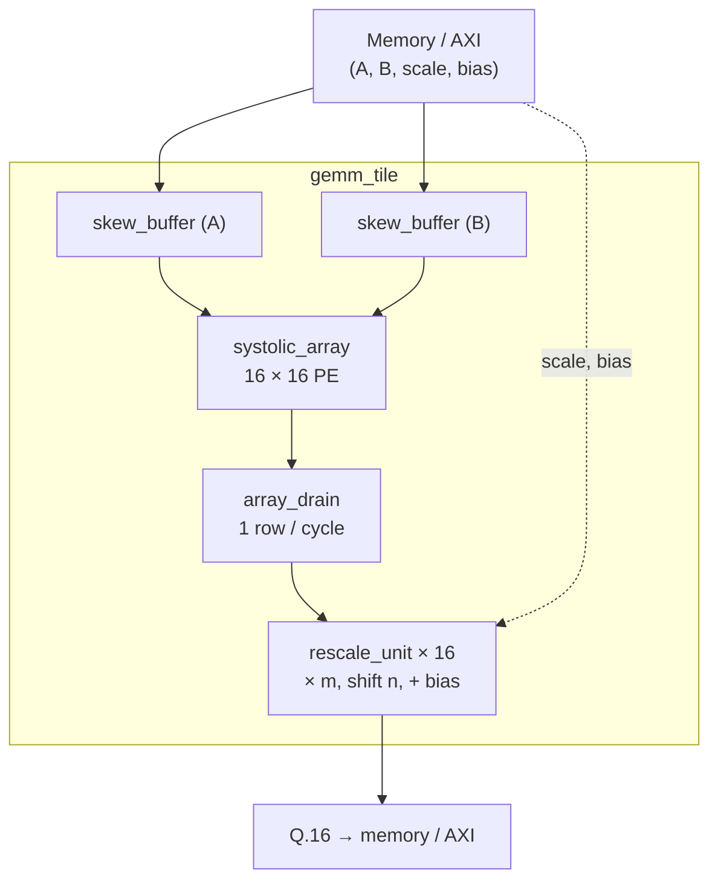

# Hardware specs (PL)

Every official RTL module has a spec file here: function, ports, behavior, timing, bit widths,
verification and synthesis results. Algorithms and arithmetic are explained in the
[guide](../guide/00%20-%20Index.md); a spec only describes **what a module does and how to use it**.

Target: KV260, part `xck26-sfvc784-2LV-c`.

## Block diagram



## Modules

| Module | Spec | RTL | Testbench | Synth | Notes |
| --- | --- | --- | --- | --- | --- |
| `pe` | [pe](pe.md) | ✅ | 🔄 being rewritten | ⬜ | INT8 MAC, forwards A/B |
| `systolic_array` | ⬜ | ✅ | ✅ | ✅ 16×16 @ 200 MHz, OOC | Output-stationary mesh; see synthesis results below |
| `sync_fifo` | ⬜ | ✅ | ✅ | ⬜ | Single-clock FIFO, show-ahead read |
| `skew_buffer` | ⬜ | ⬜ | ⬜ | ⬜ | Skews the array inputs |
| `array_drain` | ⬜ | ⬜ | ⬜ | ⬜ | Reads results one row at a time, valid/ready |
| `rescale_unit` | ⬜ | ⬜ | ⬜ | ⬜ | Bit-exact with `Scale.rescale`; write the spec before the code |
| `gemm_tile` | ⬜ | ⬜ | ⬜ | ⬜ | Combines the blocks above, tested with a real MiniLM tile |
| `tpu_top` | ⬜ | 🔄 skeleton | ⬜ | ⬜ | Top level, later connected to the PS over AXI |

✅ done · 🔄 in progress · ⬜ not started

Update this table in the same commit whenever a module's status changes.

## Synthesis results

Run out of context (OOC) with Vivado 2025.1 on `xck26-sfvc784-2LV-c`:

```bash
vivado -mode batch -source hw/synth/run_ooc.tcl -tclargs <block> [clock_mhz]
```

Reports land in `hw/synth/reports/<block>/` (`timing_target.rpt`, `utilization.rpt`,
`utilization_hier.rpt`); checkpoints and logs in `hw/synth/build/` (not tracked).

### `systolic_array` 16 × 16, 200 MHz (5.000 ns)

Top `systolic_array_ooc` (`hw/synth/wrappers/`) registers every array input, as `skew_buffer` and
the controller will; `acc_out` comes straight from the PE registers.

| Check | Result |
|---|---|
| Setup | WNS 1.070 ns, TNS 0.000 ns (0 / 32 576 failing) |
| Hold | WHS 0.010 ns, THS 0.000 ns (0 / 32 576 failing) |
| Pulse width | WPWS 2.225 ns, TPWS 0.000 ns |
| Critical path | `step_en` register → DSP `CEA2` of `row[10].col[1]`, 93.8 % routing (fanout to 256 PEs) |

| Resource | `systolic_array` | Whole OOC top | Available | Top use |
|---|---|---|---|---|
| LUT | 143 | 143 | 117 120 | 0.12 % |
| FF | 3 808 | 4 099 (+291 wrapper) | 234 240 | 1.75 % |
| DSP48E2 | 256 | 256 | 1 248 | 20.51 % |
| BRAM tile / URAM | 0 / 0 | 0 / 0 | 144 / 64 | 0 % |

Methodology: only TIMING-18 (no input/output delay on the OOC ports), expected out of context.
This is a timing check for the target FPGA, not a test on the board.

## Spec template

Every file follows the same outline (see [pe](pe.md) as an example):

1. **Function**: one or two sentences, position in the system.
2. **Parameters**: name, default, meaning.
3. **Ports**: name, direction, width, signedness, meaning.
4. **Behavior**: requirement tables R1, R2… in priority order; the testbench checks exactly these IDs.
5. **Timing**: latency, throughput, stall behavior, waveform if needed.
6. **Bit widths**: why they are sufficient; the matching NumPy function if bit-exactness is required.
7. **Verification**: which behavior is tested where.
8. **Synthesis results**: clock, WNS/TNS, WHS/THS, pulse width, LUT/FF/DSP/BRAM, report path.
9. **Change history**: major changes and their reasons.

## Conventions

- **Synchronous**, active-low reset (`rst_n`).
- All registers capture on the rising edge of `clk`; there is currently a single clock domain.
- `step_en` is the array-wide stall signal; `valid` travels with the data through every stage.
- Signed data is declared `signed` explicitly; signed right shifts use `>>>`.
- Every RTL change must come with post-place-and-route timing and utilization results (see `AGENTS.md`).
