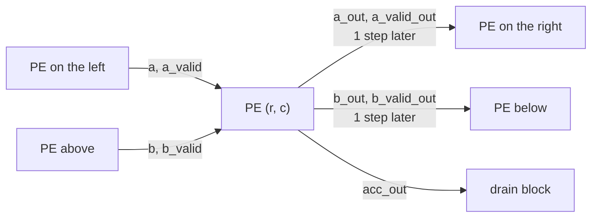
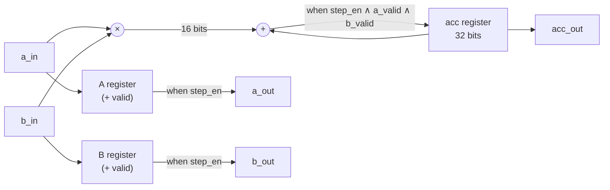

# PE — Processing Element

← [Hardware spec index](00%20-%20Hardware%20Index.md)

RTL: [`hw/rtl/compute/pe.sv`](../../hw/rtl/compute/pe.sv) · Testbench: [`hw/tb/pe_tb.sv`](../../hw/tb/pe_tb.sv)

## 1. Function

One multiply-accumulate (MAC) cell of an **output-stationary** systolic array. On every step the PE:

1. Multiplies the two INT8 operands at its inputs and adds the product to its internal
   accumulator (if both are valid).
2. Forwards operand A to the PE on its right and operand B to the PE below, one step later.

The accumulator **stays in the PE** for a whole tile: after $K$ operand pairs have passed,
`acc_out` holds $\sum_k A_{ik} B_{kj}$ for exactly one element of the result matrix.

**Position in the array:**

**Internal structure:**

The multiplier and adder sit between the inputs and the `acc` register with no intermediate
register (single-cycle MAC). The A and B registers only forward data and take no part in the multiply.

## 2. Parameters

| Name | Default | Meaning |
| --- | --- | --- |
| `A_WIDTH` | 8 | Width of operand A (signed) |
| `B_WIDTH` | 8 | Width of operand B (signed) |
| `ACC_WIDTH` | 32 | Width of the accumulator (signed) |

Constraint: `ACC_WIDTH ≥ A_WIDTH + B_WIDTH`.

## 3. Ports

| Name          | Dir | Width               | Meaning                                           |
| ------------- | --- | ------------------- | ------------------------------------------------- |
| `clk`         | in  | 1                   | Clock; every register captures on the rising edge |
| `rst_n`       | in  | 1                   | **Synchronous** reset, active low                 |
| `step_en`     | in  | 1                   | Enables one array step; `0` stalls                |
| `acc_clear`   | in  | 1                   | Clears the accumulator to 0 before a new tile     |
| `a_in`        | in  | `A_WIDTH`, signed   | Operand A from the PE on the left                 |
| `a_valid_in`  | in  | 1                   | `a_in` is valid                                   |
| `b_in`        | in  | `B_WIDTH`, signed   | Operand B from the PE above                       |
| `b_valid_in`  | in  | 1                   | `b_in` is valid                                   |
| `a_out`       | out | `A_WIDTH`, signed   | A forwarded to the right                          |
| `a_valid_out` | out | 1                   | Valid of `a_out`                                  |
| `b_out`       | out | `B_WIDTH`, signed   | B forwarded downwards                             |
| `b_valid_out` | out | 1                   | Valid of `b_out`                                  |
| `acc_out`     | out | `ACC_WIDTH`, signed | Accumulator value (straight from the register)    |

## 4. Behavior

All changes happen on the rising edge of `clk`. `x'` denotes the value after the edge. Each
requirement has an ID (R1…R9) that the testbench refers to.

### 4.1. Accumulator

Conditions are checked in order; the **first** one that holds is applied:

| # | Condition | `acc_out'` |
|---|---|---|
| R1, R7 | `rst_n = 0` | `0` (wins over both `acc_clear` and MAC) |
| R6 | `acc_clear = 1` | `0` (even when `step_en = 0`) |
| R2 | `step_en = 1` **and** `a_valid_in = 1` **and** `b_valid_in = 1` | `acc_out + a_in × b_in` |
| R3 | otherwise | `acc_out` (held) |

Consequences:
- **R6:** if `acc_clear = 1` in the same cycle as a valid MAC, that cycle's product is
  **discarded** and not added to the new tile. The controller must assert `acc_clear` **before**
  the first operand pair of a tile.
- **R2:** the MAC uses `a_in`, `b_in` **at the inputs** in the current cycle, not `a_out`, `b_out`.

### 4.2. Operand forwarding

| # | Condition | `a_out'`, `b_out'` | `a_valid_out'`, `b_valid_out'` |
|---|---|---|---|
| R1 | `rst_n = 0` | held (**not reset**) | `0` |
| R4 | `step_en = 1` | `a_in`, `b_in` | `a_valid_in`, `b_valid_in` |
| R5 | `step_en = 0` | held | held |

- Operands are forwarded **even when valid = 0**: valid travels with the data, so downstream PEs
  ignore it.
- `acc_clear` does **not** affect the forwarding path.
- `a_out`, `b_out` are not reset to save logic. After reset they may be `X` until the first
  `step_en = 1`. This is safe because the output valids are already 0.

### 4.3. Arithmetic

| # | Behavior |
|---|---|
| R8 | `a_in × b_in` is a **signed** multiply with an `A_WIDTH + B_WIDTH`-bit result. Correct at all extremes: $(-128)(-128) = 16384$, $127 \cdot 127 = 16129$, $(-128) \cdot 127 = -16256$ |
| R9 | The product is sign-extended to `ACC_WIDTH` and added. On overflow the accumulator **wraps** in two's complement; it does not saturate |

## 5. Timing

| Quantity | Value |
|---|---|
| Forwarding latency (`a_in` → `a_out`) | 1 step with `step_en = 1` |
| MAC latency (`a_in`, `b_in` → `acc_out`) | 1 cycle |
| Throughput | 1 MAC per cycle |
| Internal pipeline stages | 0: multiply and add in the same cycle |

**Cycle-by-cycle example** with one stall cycle. The "input" column is the value applied during
that cycle; the "after edge" columns are the register values right after the rising edge that ends
the cycle. $p_k = a_k \cdot b_k$, all valids are 1.

| Cycle | `step_en` | `a_in`, `b_in` (input) | `a_out` (after edge) | `acc_out` (after edge) | Note |
| :---: | :---: | :---: | :---: | :---: | --- |
| 0 | 1 | $a_0, b_0$ | $a_0$ | $p_0$ | MAC |
| 1 | 1 | $a_1, b_1$ | $a_1$ | $p_0 + p_1$ | MAC |
| 2 | **0** | $a_2, b_2$ | $a_1$ | $p_0 + p_1$ | **Stall**: no MAC, no forwarding |
| 3 | 1 | $a_2, b_2$ | $a_2$ | $p_0 + p_1 + p_2$ | $a_2, b_2$ held one extra cycle, then the step proceeds |
| 4 | 1 | $a_3, b_3$ | $a_3$ | $p_0 + \dots + p_3$ | MAC |

During a stall the data source must **hold** its inputs until a cycle with `step_en = 1`. The PE
does not store the inputs of a stalled cycle.

In the array, the PE at row $r$, column $c$ sees $A_{r,k}$ and $B_{k,c}$ together at step
$k + r + c$, provided the inputs are skewed correctly.

## 6. Bit widths

| Signal | Width | Note |
|---|---|---|
| `a_in × b_in` | 16 bits signed | |
| `acc_out` | 32 bits signed | |

Practical bound for MiniLM, $K \le 1536$, symmetric INT8 codes $[-127, 127]$:

$$
|\mathrm{acc}| \le 1536 \cdot 127^2 = 24\,774\,144 < 2^{25}
$$

i.e. **26 signed bits** are needed. 32 bits leave 6 bits of margin, so the accumulator **never
overflows** with model data; R9 only describes behavior beyond this bound. The matching accumulator
in the NumPy model is declared 32 bits (`ACCUMULATOR_BITS` in `model/numpy/layers/linear.py`).

**Hardware mapping:** the `(* use_dsp = "yes" *)` attribute asks Vivado to place the
multiply-accumulate in a **DSP48E2** (27 × 18 multiply, 48-bit accumulate). Each PE uses 1 DSP; a
16 × 16 array uses 256 of the XCK26's 1248 DSPs.

## 7. Verification

Testbench: `hw/tb/pe_tb.sv`, self-checking against a reference model written in SV.

| Requirement | Test |
| --- | --- |
| R1, R7 | Initial reset; reset while accumulating and while clearing |
| R2 | Directed MAC sequence with hand-computed results |
| R3 | Disable `a_valid_in`, `b_valid_in`, `step_en` one at a time |
| R4, R5 | Change inputs continuously during a stall; outputs must hold |
| R6 | Clear during a stall; clear in the same cycle as a valid MAC |
| R8 | Extreme pairs −128, −127, −1, 0, 1, 127 |
| R9 | Overflow past $2^{31}$, or the practical bound $K = 1536$ |
| All | Tens of thousands of random cycles with random reset and clear |

> [!todo] Status
> The testbench is being rewritten after removing `acc_load` / `acc_init`. Update this table when
> done, including the list of deliberately injected bugs the testbench catches.

## 8. Synthesis results

> [!todo] Not yet available
> Synthesis / place-and-route has not been run for the PE alone. When it is, record: part
> `xck26-sfvc784-2LV-c`, target clock, WNS/TNS, WHS/THS, pulse width, LUT/FF/DSP/BRAM, and the
> report path.

## 9. Change history

| Change | Reason |
|---|---|
| Removed `acc_load` / `acc_init` | The bias is added in Q.16 after rescale; an output-stationary array accumulates the whole $K$ itself, so partial sums never need reloading |
