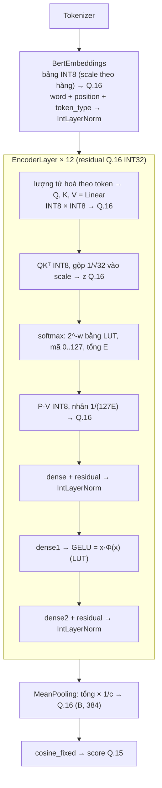

# Mô hình NumPy số nguyên mô phỏng FPGA

Thư mục này mô phỏng cách FPGA tính sentence embedding và score RAG của MiniLM
(`paraphrase-multilingual-MiniLM-L12-v2`, file `model/weights/model.onnx` bản float32).
**Toàn bộ đường tính lúc chạy là số nguyên**: chỉ có cộng, nhân, dịch bit, so sánh và tra
LUT. Các phép chia, căn, `exp`, `erf` và số thực chỉ xuất hiện ở bước chuẩn bị offline
(`prepare_*`, `__init__`) và ở `to_float` (dùng để in trace).

Công thức chi tiết, viết bằng KaTeX, nằm ở
[docs/integer_arithmetic.md](../../docs/integer_arithmetic.md).

## Luồng hoạt động



| Bước | File |
|---|---|
| Embedding | `layers/bert_embedding.py` |
| `Linear` (systolic array) | `layers/linear.py` |
| Self-attention, softmax | `layers/self_attention.py`, `utils/softmax.py` |
| Attention output, FFN | `layers/attention_output.py`, `layers/feed_forward.py`, `utils/gelu.py` |
| LayerNorm | `layers/int_layer_norm.py` |
| Pooling | `layers/mean_pooling.py` |
| Score cosine | `utils/similarity.py` |
| Lượng tử hoá | `utils/int_quantize.py` |
| rsqrt, nghịch đảo | `utils/rsqrt.py`, `utils/reciprocal.py` |
| Dịch bit, kiểm tra tràn | `utils/fixed.py` |

## Biểu diễn dữ liệu

- **Tensor rộng**: Q.16 trong INT32. Dùng cho residual stream, đầu ra `Linear`, LayerNorm,
  GELU và pooling. Cộng residual chỉ là phép cộng số nguyên.
- **Tensor hẹp**: INT8 kèm scale $m \cdot 2^{-n}$ ($m \le 127$, $n$ 5 bit). Chỉ dùng làm đầu
  vào của phép nhân ma trận.
  - Weight: scale theo cột.
  - Đầu vào `Linear`, $Q$, $K$: scale theo token.
  - $V$: scale theo kênh.

Chọn scale như vậy vì INT8 per-tensor (thiết kế cũ) chỉ đạt cosine 0.85 so với PyTorch:
activation có vài kênh outlier rất lớn, làm các giá trị còn lại chỉ dùng được vài mức INT8.

## Kết quả

So với PyTorch float32, trên các câu thử:

| Đại lượng | INT8 per-tensor (cũ) | Hiện tại |
|---|---|---|
| Cosine của sentence embedding | 0.847 – 0.914 | 0.9983 – 0.9997 |
| Sai số trung bình / lớn nhất | 7.1% / 25.6% | ~0.6% / ~3.5% |
| Sai số score RAG lớn nhất | 0.087 | 0.013 |

## Chạy

Cần file `model/weights/model.onnx`. Cài đặt môi trường xem trong tài liệu ở trên.

```bash
python model/main.py
```

Lệnh trên hỏi câu truy vấn và các đoạn tài liệu (bấm Enter để dùng mặc định), rồi in:
- sai số từng bước của embedding;
- sai số sentence embedding của từng câu;
- score RAG của PyTorch và NumPy, sai số score, thứ hạng.

```bash
python model/numpy/main.py
```

Lệnh trên chỉ chạy model NumPy và in trace của từng layer.

```bash
python -m unittest model.test_numpy_model -v
```

Lệnh trên chạy test cho từng khối số nguyên (không cần weights), cộng một test end-to-end
so với PyTorch, chỉ chạy khi có `model.onnx`.

## File không còn dùng

Đường tính mới không còn dùng các file sau. Chúng vẫn được giữ lại để tham khảo:
- `utils/quantize.py`, `utils/scale_int12.py`, `utils/scale.py`, `utils/int8.py`, `utils/int32.py`: lượng tử hoá INT8 per-tensor với `ScaleInt12`.
- `layers/layer_norm.py`: LayerNorm float.
