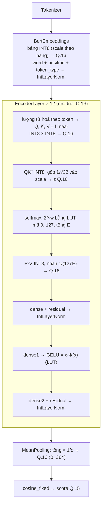

# Mô hình NumPy số nguyên mô phỏng FPGA

Thư mục này mô phỏng, **chính xác từng bit**, cách FPGA (KV260) tính sentence embedding và
score RAG của MiniLM (`paraphrase-multilingual-MiniLM-L12-v2`, trọng số lấy từ
`model/weights/model.onnx` bản float32). Model này là mô hình tham chiếu (golden model) cho RTL.

- **Lúc chạy chỉ dùng phép số nguyên:** cộng, trừ, nhân, dịch bit, so sánh, tra bảng (LUT/ROM).
- **Không dùng:** chia, căn, `exp`, `erf`, số thực. Các phép này chỉ xuất hiện ở bước chuẩn bị
  **offline** (các hàm `prepare_*`, `quantize_weight`, phần `__init__` của mỗi layer) để tạo
  hằng số và bảng tra.
- Mọi tensor lúc chạy đều có **độ rộng bit khai báo rõ ràng**, như một thanh ghi trên FPGA.

Phần chứng minh công thức chi tiết hơn nằm ở
[docs/integer_arithmetic.md](../../docs/integer_arithmetic.md).

## Mục lục

1. [Kiểu dữ liệu phần cứng (`hwtypes/`)](#1-kiểu-dữ-liệu-phần-cứng-hwtypes)
2. [Cách lưu số](#2-cách-lưu-số)
3. [Lượng tử hoá](#3-lượng-tử-hoá)
4. [Luồng tính tổng thể](#4-luồng-tính-tổng-thể)
5. [Embedding](#5-embedding)
6. [Linear (nhân ma trận)](#6-linear-nhân-ma-trận)
7. [Self-attention và softmax](#7-self-attention-và-softmax)
8. [Cộng residual](#8-cộng-residual)
9. [LayerNorm](#9-layernorm)
10. [GELU](#10-gelu)
11. [Mean pooling](#11-mean-pooling)
12. [Score RAG: cosine](#12-score-rag-cosine)
13. [rsqrt và nghịch đảo](#13-rsqrt-và-nghịch-đảo)
14. [Bảng thanh ghi và LUT](#14-bảng-thanh-ghi-và-lut)
15. [Độ chính xác](#15-độ-chính-xác)
16. [Chạy và kiểm thử](#16-chạy-và-kiểm-thử)

---

## 1. Kiểu dữ liệu phần cứng (`hwtypes/`)

Mọi số lúc chạy đều là một đối tượng `Fixed` (mảng) hoặc `Scale`, không phải mảng `int64` trần.
Nhờ vậy mỗi phép tính đều biết kết quả cần bao nhiêu bit, và mỗi thanh ghi đều được kiểm tra tràn.

| File | Nội dung |
|---|---|
| [`hwtypes/fixed.py`](hwtypes/fixed.py) | `Fixed`, các kiểu đặt sẵn, `where`, `leading_one` |
| [`hwtypes/scale.py`](hwtypes/scale.py) | `ScaleFormat`, `Scale`, `QTensor` |

### 1.1. `Fixed`: mảng số nguyên có định dạng thanh ghi

```python
Fixed(raw, bits, frac=0, signed=True, overflow="error", name=None)
```

| Thuộc tính | Ý nghĩa |
|---|---|
| `raw` | Giá trị nguyên (lưu bằng `np.int64` để NumPy không tràn) |
| `bits` | Độ rộng thanh ghi, tính cả bit dấu (1..63) |
| `signed` | Có dấu (bù 2) hay không dấu |
| `frac` | Số bit thập phân: giá trị thật $= \text{raw} \cdot 2^{-\text{frac}}$ |

Định dạng chỉ là thông tin đi kèm. Mọi phép tính làm trên `raw`, đúng như RTL làm trên các bit.

**Tạo giá trị:**

| Cách tạo | Dùng khi |
|---|---|
| `Fixed(raw, bits, frac, signed)` | Có sẵn giá trị nguyên |
| `Fixed.from_float(x, bits, frac)` | Offline: làm tròn số thực về mã gần nhất (bias, gamma, beta) |
| `Fixed.const(v)` | Hằng số (literal), tự chọn độ rộng nhỏ nhất vừa giá trị |
| `x.to_float()` | Chỉ để debug và in trace |

**Kiểu đặt sẵn** (tạo bằng `fixed_type(name, bits, frac, signed)`):

| Kiểu | Định dạng |
|---|---|
| `Int8`, `Int16`, `Int32` | có dấu, 8 / 16 / 32 bit, `frac = 0` |
| `UInt8` | không dấu 8 bit |
| `Q16` | có dấu 32 bit, `frac = 16`: định dạng của residual stream |

```python
from model.numpy.hwtypes import Int8, Q16, fixed_type

a = Int8([100, -50])
x = Q16.from_float([1.5, -0.25])         # raw = [98304, -16384]
UInt5 = fixed_type("UInt5", 5, signed=False)
```

### 1.2. Phép tính và quy tắc độ rộng

Các phép tính được overload theo quy tắc của HDL: **kết quả luôn đủ bit, không bao giờ tự
cắt**.

| Phép | Độ rộng kết quả | `frac` của kết quả |
|---|---|---|
| `a + b`, `a - b` | rộng hơn toán hạng rộng nhất 1 bit | hai bên phải bằng nhau, nếu không sẽ báo lỗi |
| `-a`, `abs(a)` | thêm 1 bit / giữ nguyên (`abs` trả về không dấu) | giữ nguyên |
| `a * b` | `a.bits + b.bits` | `a.frac + b.frac` |
| `a @ b` (MAC trên $K$ phần tử) | `a.bits + b.bits` $+ \lceil \log_2 K \rceil$ | cộng lại |
| `a.sum(axis)` trên $n$ phần tử | `bits` $+ \lceil \log_2 n \rceil$ | giữ nguyên |
| `a.max()`, `a.min()` | giữ nguyên | giữ nguyên |

Ví dụ: `Int8 * Int8` ra 16 bit; `Int8 @ Int8` với $K = 384$ ra $8 + 8 + 9 = 25$ bit.

**Trộn có dấu và không dấu:** kết quả có dấu nếu một trong hai có dấu; số không dấu $u$ bit
được coi như số có dấu $u + 1$ bit khi cộng với số có dấu.

**Hằng số Python** (`int` hoặc mảng NumPy nguyên) được xử lý như literal trong HDL: khi cộng/trừ
thì dùng chung `frac` với toán hạng kia; khi nhân thì là số nguyên (`frac = 0`).

Nếu độ rộng tính theo quy tắc vượt 63 bit (giới hạn của `int64`), `Fixed` dùng độ rộng thực tế
của dữ liệu. Nếu dữ liệu thật sự cần hơn 63 bit thì báo `OverflowError`.

### 1.3. Dịch bit

| Phép | Ý nghĩa | `frac` |
|---|---|---|
| `a >> k`, `a << k` | Dịch bit thô (dịch phải là dịch số học, làm tròn xuống) | **giữ nguyên** |
| `a.round_shift(k)` | Dịch phải **làm tròn nửa lên**; $k < 0$ là dịch trái | `frac - k` |
| `a.floor_shift(k)` | Dịch phải làm tròn xuống; $k < 0$ là dịch trái | `frac - k` |
| `a & mask` | Giữ các bit thấp (mask là literal không âm) | giữ nguyên |

`round_shift` và `floor_shift` dùng để **đổi định dạng Q**: dịch $k$ bit thì giá trị thật không
đổi, chỉ mất bớt độ chính xác, nên `frac` giảm $k$. Khi lượng dịch `k` là một mảng (mỗi phần tử
dịch khác nhau), phải truyền `frac=` của kết quả, vì không có một `frac` chung tự suy ra được.

$$
\operatorname{round\_shift}(x, k) =
\begin{cases}
\left(x + 2^{k-1}\right) \gg k & k > 0 \\
x & k = 0 \\
x \ll (-k) & k < 0
\end{cases}
$$

Ví dụ: `Q16 * (Q.15)` ra `frac = 31`; `.round_shift(15)` đưa về `frac = 16`.

### 1.4. Khai báo thanh ghi: `resize`

```python
acc = (x.codes @ w.codes).resize(32, name="accumulator")
```

`resize(bits, signed=None, overflow="error", name=None)` là nơi **khai báo một thanh ghi** trên
FPGA. Nếu dữ liệu không vừa:

| `overflow` | Hành vi |
|---|---|
| `"error"` (mặc định) | Báo `OverflowError`, kèm tên thanh ghi và số bit thực sự cần |
| `"wrap"` | Bỏ bit cao (tràn kiểu bù 2) |
| `"saturate"` | Bão hoà về giá trị lớn/nhỏ nhất |

Ngoài ra `with_frac(f)` đổi cách hiểu `frac` mà không đổi bit nào, còn `required_bits()` cho
biết dữ liệu hiện tại thật sự cần bao nhiêu bit.

### 1.5. Các khối logic nhỏ

| Hàm | Phần cứng tương ứng |
|---|---|
| `x.clip(lo, hi)` | Bão hoà; độ rộng thu về vừa khoảng $[lo, hi]$ |
| `where(cond, a, b)` | Bộ chọn (multiplexer) |
| `leading_one(x)` | Bộ mã hoá ưu tiên: số bit cần để biểu diễn $x \ge 0$ |
| `lut[address]` | Đọc ROM/LUT; `address` là `Fixed`, ngoài bảng sẽ báo `IndexError` |
| `x.max(axis, where=mask)` | Cây so sánh, bỏ qua phần tử bị mask |

### 1.6. `Scale`: hệ số $m \cdot 2^{-n}$

Mọi hệ số tỉ lệ đều có dạng $S = m \cdot 2^{-n}$ với $m$, $n$ là số nguyên không dấu. Nhân với
$S$ trên phần cứng chỉ cần **một bộ nhân** (với $m$) và **một bộ dịch** (theo $n$).

**`ScaleFormat(m_bits=7, n_bits=5)`** khai báo độ rộng hai trường và có thể đổi tuỳ ý:

| Thuộc tính / hàm | Ý nghĩa |
|---|---|
| `m_max`, `n_max` | $2^{m\_bits} - 1$, $2^{n\_bits} - 1$ (mặc định 127 và 31) |
| `scale(m, n)` | Tạo `Scale`, kiểm tra hai trường vừa định dạng |
| `from_float(s)` | Offline: chọn $(m, n)$ cho số thực $s$ (mục 3.1) |
| `from_peak(peak, code_max)` | Lúc chạy, chỉ dùng số nguyên: chọn $(m, n) \approx \text{peak} / \text{code\_max}$ (mục 3.2) |

**`Scale(m, n)`** gồm hai trường `Fixed`, có shape để broadcast với tensor:

| Phép | Ý nghĩa |
|---|---|
| `S1 * S2` | $m = m_1 m_2$, $n = n_1 + n_2$; giữ đủ bit, không làm tròn |
| `S.rescale(value, frac)` | $\text{value} \cdot m \cdot 2^{-n}$, kết quả ở Q.`frac`: **một phép nhân, một phép dịch có làm tròn** |
| `S[idx]`, `S.swapaxes(...)` | Chọn hàng, đổi trục, như mảng |
| `S.pack()` | Ghép $\{m, n\}$ thành một word $m\_bits + n\_bits$ bit (12 bit với mặc định) |
| `Scale.const(m, n)` | Hằng số, ví dụ $1/\sqrt{32} \approx$ `Scale.const(5793, 15)` |
| `S.to_float()` | Chỉ để debug |

### 1.7. `QTensor`

`QTensor(codes, scale)` là cặp **mã số nguyên** (`Fixed`, thường là INT8) và **scale** của nó:
giá trị thật $\approx \text{codes} \cdot m \cdot 2^{-n}$. `dequantize()` chỉ dùng để debug.

### 1.8. Ví dụ: một phần tử của `Linear`

```python
from model.numpy.hwtypes import Fixed, Scale

acc = Fixed.const(-26375)                         # tổng MAC INT8 x INT8
scale = Scale.const(76, 12) * Scale.const(80, 16) # S_x * S_w -> m = 6080, n = 28
y = scale.rescale(acc, frac=16)                   # (-26375 * 6080) >> 12 = -39150, Q.16
y.to_float()                                      # -0.5974
```

---

## 2. Cách lưu số

### 2.1. Hai loại tensor

| Loại | Định dạng | Dùng cho |
|---|---|---|
| **Rộng** | `Q16`: số có dấu 32 bit, 16 bit thập phân | Residual stream, đầu ra `Linear`, LayerNorm, GELU, pooling, bias, beta |
| **Hẹp** | `QTensor`: mã INT8 $[-127, 127]$ + `Scale` $m \cdot 2^{-n}$ | **Chỉ** làm đầu vào của phép nhân ma trận (systolic array) |

Mọi tensor rộng dùng chung đơn vị $2^{-16}$, nên cộng residual chỉ là phép cộng số nguyên.
Tensor hẹp chỉ xuất hiện ngay trước mỗi phép nhân ma trận, và kết quả được đổi về Q.16 ngay sau đó.

Mã INT8 là **đối xứng**: dùng $[-127, 127]$, bỏ $-128$, để $|x|$ luôn vừa 7 bit và không có
trường hợp lệch.

### 2.2. Scale: định dạng 7 + 5 bit

$$
S = m \cdot 2^{-n}, \qquad m \in [1, 127]\ (7 \text{ bit}), \quad n \in [0, 31]\ (5 \text{ bit})
$$

$n$ cần 5 bit vì scale theo kênh của weight thường cỡ $10^{-3}$–$10^{-4}$, nhỏ hơn $2^{-15}$.
Nếu $n$ chỉ có 4 bit ($n \le 15$) thì $m$ chỉ còn vài đơn vị và mất độ chính xác. Trên MiniLM,
$n$ của weight `Linear` nằm trong khoảng 11..18, của bảng word embedding trong khoảng 14..22.

Scale được chọn sao cho $m$ lớn nhất có thể; với mọi weight của MiniLM, $m \in [64, 127]$, nên
luôn có đủ 7 bit có nghĩa.

### 2.3. Trọng số và hằng số (tính offline)

| Dữ liệu | Lưu dưới dạng | Shape của scale |
|---|---|---|
| Weight `Linear` $(K, \text{out})$ | `QTensor`: INT8 + scale **theo cột** (kênh ra) | $(1, \text{out})$ |
| Bảng embedding (word, position, token type) | `QTensor`: INT8 + scale **theo hàng** | $(V, 1)$ |
| Bias `Linear` | `Fixed` Q.16, 32 bit, mỗi kênh ra một giá trị | — |
| LayerNorm $\gamma$ | $G = \gamma \sqrt{384}$ ở Q.10, 18 bit | — |
| LayerNorm $\beta$ | Q.16, 32 bit | — |
| $1/\sqrt{32}$ | `Scale.const(5793, 15)` | — |
| $\log_2 e$ | Q.15: 47274 | — |
| LUT (exp2, GELU, rsqrt, nghịch đảo, $1/m$) | `Fixed` không dấu, xem mục 14 | — |

Bias **không** được lượng tử hoá theo scale của accumulator như cách INT8 thông thường. Lý do:
scale của input thay đổi theo từng token lúc chạy, nên không tính trước được bias ở scale
$S_x S_w$. Thay vào đó bias được cộng **sau** khi kết quả đã về Q.16.

### 2.4. Ranh giới với phần mềm

Bên trong model, mọi thứ là `Fixed`. Ở rìa ngoài:

- `SentenceEmbeddingModel.__call__` trả về **mảng `np.int32` thô**, ở Q.16, shape $(B, 384)$.
- `cosine_fixed(a, b)` nhận mảng thô Q.16 hoặc `Fixed`, trả về **mảng `np.int32` thô** ở Q.15.

---

## 3. Lượng tử hoá

Code: [`utils/int_quantize.py`](utils/int_quantize.py), [`hwtypes/scale.py`](hwtypes/scale.py).

### 3.1. Weight (offline, `quantize_weight`)

Mỗi lát cắt (một cột weight, hoặc một hàng bảng embedding) có scale riêng. Chọn $n$ lớn nhất để
$m$ vừa 7 bit, và **làm tròn $m$ lên**:

$$
s = \frac{\max |W_{:,j}|}{127}, \qquad
n_j = \max\left\{ n \le 31 \;\middle|\; \lceil s \cdot 2^{n} \rceil \le 127 \right\}, \qquad
m_j = \left\lceil s \cdot 2^{n_j} \right\rceil
$$

$$
W_{q,kj} = \operatorname{clip}\!\left(\operatorname{rint}\!\left(\frac{W_{kj}}{m_j 2^{-n_j}}\right), -127, 127\right)
$$

Làm tròn $m$ lên bảo đảm $m_j 2^{-n_j} \ge s$, nên phần tử lớn nhất cho mã $\le 127$: không
phần tử nào bị cắt, và sai số luôn $\le \tfrac{1}{2}$ bước.

### 3.2. Activation (lúc chạy, `quantize`)

Đầu vào là `Fixed` (thường Q.16). Mỗi hàng (token) có scale riêng. Tất cả là phép số nguyên.

1. **Tìm đỉnh:** $P = \max_k |x_k|$.
2. **Chia cho 127 bằng phép nhân** (`ScaleFormat.from_peak`): nhân với hằng
   $R = \lceil 2^{24} / 127 \rceil = 132\,105$, được $P \cdot R \approx (P / 127) \cdot 2^{24}$.
3. **Chọn $n$:** tạo cả 32 ứng viên $m(n) = \lceil P \cdot R \cdot 2^{n - 40} \rceil$ (dịch phải
   làm tròn lên), rồi lấy $n$ lớn nhất mà $m(n) \le 127$, giống bộ mã hoá ưu tiên. Nếu $P = 0$
   thì $m = 1$, $n = 31$.
4. **Tính mã** $x / S$ mà không chia: tra ROM nghịch đảo $\mathrm{RECIP}[m] = \operatorname{round}(2^{22}/m)$
   (128 ô, 23 bit), rồi

$$
x_{q,k} = \operatorname{clip}\!\Big(\operatorname{round\_shift}\!\left(x_k \cdot \mathrm{RECIP}[m],\ 22 + 16 - n\right),\ -127,\ 127\Big)
$$

Tích $x_k \cdot \mathrm{RECIP}[m]$ là $32 \times 23$ bit, tức khoảng 55 bit. Đây là phép nhân
rộng nhất của cả model; khi viết RTL nên thu hẹp lại (xem phần lưu ý ở mục 14).

`quantize(x, axis, scale_format=..., code_bits=...)` cho phép thử định dạng khác, ví dụ
`ScaleFormat(m_bits=5, n_bits=4)` với mã 6 bit.

### 3.3. Scale theo chiều nào

| Tensor | Scale theo | Shape của $(m, n)$ |
|---|---|---|
| Weight `Linear` | cột (kênh ra) | $(1, \text{out})$ |
| Bảng embedding | hàng (token ID) | $(V, 1)$ |
| Đầu vào `Linear` | token | $(B, L, 1)$ |
| $Q$, $K$ | token × head | $(B, H, L, 1)$ |
| $V$ | kênh × head | $(B, H, 1, D)$ |

Quy tắc: scale phải **nằm ngoài tổng** của phép nhân ma trận. Với $XW$, tổng chạy theo $k$, nên
scale được phép phụ thuộc hàng $i$ của $X$ và cột $j$ của $W$. Với context $PV$, tổng chạy theo
token, nên $V$ phải có scale theo kênh, không theo token.

Lý do dùng scale theo token và theo kênh thay cho một scale cho cả tensor: activation của
transformer có vài kênh outlier rất lớn. Với một scale chung, các giá trị bình thường chỉ dùng
được vài mức INT8 (cosine chỉ 0.85 so với PyTorch). Với scale riêng, cosine lên 0.998.

### 3.4. Đổi kết quả về Q.16: vì sao chỉ cần nhân $m$ và dịch $n$

Accumulator INT8 × INT8 có đơn vị $S_x S_w = (m_x m_w) \cdot 2^{-(n_x + n_w)}$. `Scale.rescale`
làm hai việc:

| Bước | Số nguyên | Một đơn vị bằng |
|---|---|---|
| Sau MAC | `acc` | $m_x m_w \cdot 2^{-(n_x + n_w)}$ |
| Nhân với $m_x m_w$ | `acc · m` | $2^{-(n_x + n_w)}$: chỉ còn lũy thừa của 2 |
| Dịch phải $n_x + n_w - 16$ | `y` | $2^{-16}$, tức Q.16 |

Phép nhân với $m$ là chính xác (số nguyên). Sai số duy nhất là phép dịch, tối đa ½ LSB của Q.16.
Sau đó cộng bias (cũng Q.16) trực tiếp.

---

## 4. Luồng tính tổng thể



| Bước | File |
|---|---|
| Kiểu dữ liệu | `hwtypes/fixed.py`, `hwtypes/scale.py` |
| Lượng tử hoá | `utils/int_quantize.py` |
| Embedding | `layers/bert_embedding.py` |
| `Linear` | `layers/linear.py` |
| Self-attention, softmax | `layers/self_attention.py`, `utils/softmax.py` |
| Attention output, FFN, GELU | `layers/attention_output.py`, `layers/feed_forward.py`, `utils/gelu.py` |
| LayerNorm | `layers/int_layer_norm.py` |
| Pooling | `layers/mean_pooling.py` |
| Score cosine | `utils/similarity.py` |
| rsqrt, nghịch đảo | `utils/rsqrt.py`, `utils/reciprocal.py` |
| Ráp cả model | `model.py`; đọc ONNX: `weights.py`; hằng số: `config.py` |

Ký hiệu dùng ở các mục sau: $N = 384$ (hidden), $H = 12$ head, $D = 32$ chiều mỗi head,
$F = 1536$ (FFN), $L \le 128$ token. $[x]$ là giá trị Q.16 của $x$.

---

## 5. Embedding

Code: [`layers/bert_embedding.py`](layers/bert_embedding.py).

- **Offline:** ba bảng (word $250\,037 \times 384$, position $512 \times 384$, token type
  $2 \times 384$) được lượng tử hoá INT8, mỗi hàng một scale (mục 3.1).
- **Lúc chạy:** đọc một hàng mã INT8 và scale của hàng đó, đổi về Q.16:

$$
[e_k] = \operatorname{round\_shift}\!\left(q_k \cdot m,\ n - 16\right)
\qquad (\texttt{table.scale[ids].rescale(table.codes[ids], 16)})
$$

Phép nhân là $8 \times 7$ bit. Sau đó cộng ba vector (Q.16, cộng thẳng) và đưa qua LayerNorm:

$$
[x] = [e_{\text{word}}] + [e_{\text{pos}}] + [e_{\text{type}}]
$$

Position ID là bộ đếm $0, 1, \dots, L-1$.

---

## 6. Linear (nhân ma trận)

Code: [`layers/linear.py`](layers/linear.py).

$$
y_{ij} = \sum_{k=1}^{K} x_{ik} W_{kj} + b_j, \qquad K \in \{384, 1536\}
$$

Thay $x_{ik} \approx x_{q,ik} S_{x,i}$ (scale theo token) và $W_{kj} \approx W_{q,kj} S_{w,j}$
(scale theo cột). Hai scale nằm ngoài tổng:

$$
y_{ij} \approx S_{x,i} S_{w,j} \underbrace{\sum_{k} x_{q,ik} W_{q,kj}}_{\mathrm{acc}_{ij}} + b_j
$$

**Các bước:**

1. `quantize(x)`: mã INT8 + scale theo token (mục 3.2).
2. **Systolic array chỉ làm MAC INT8:** $\mathrm{acc} = x_q W_q$, thanh ghi 32 bit
   (thực tế $|\mathrm{acc}| \le 1536 \cdot 127^2 < 2^{25}$).
3. **Đổi về Q.16 và cộng bias:**

$$
[y_{ij}] = \operatorname{round\_shift}\!\Big(\mathrm{acc}_{ij} \cdot (m_{x,i}\, m_{w,j}),\ n_{x,i} + n_{w,j} - 16\Big) + [b_j]
$$

```python
output = (x.scale * self.weight.scale).rescale(accumulator, FRAC_BITS) + self.bias
```

| Tín hiệu | Độ rộng |
|---|---|
| $x_q$, $W_q$ | 8 bit |
| $\mathrm{acc}$ | thanh ghi 32 bit (dữ liệu $\le 26$ bit) |
| $m_x m_w$ | 14 bit |
| $\mathrm{acc} \cdot m_x m_w$ | $\le 40$ bit |
| $[y]$ | thanh ghi 32 bit, Q.16 |

Trong self-attention, $Q$, $K$, $V$ dùng chung **một lần** lượng tử hoá đầu vào
(`forward_quantized`).

---

## 7. Self-attention và softmax

Code: [`layers/self_attention.py`](layers/self_attention.py), [`utils/softmax.py`](utils/softmax.py).

$$
\operatorname{Attention}(Q, K, V) = \operatorname{softmax}\!\left(\frac{Q K^\top}{\sqrt{D}} + M\right) V
$$

### 7.1. Q, K, V

Ba phép `Linear` cho $[Q], [K], [V]$ ở Q.16, tách thành 12 head, rồi lượng tử hoá lại: $Q$ và $K$
theo token, $V$ theo kênh (mục 3.3).

### 7.2. Điểm attention

$$
\mathrm{sacc}_{ij} = \sum_{d=1}^{32} Q_{q,id}\, K_{q,jd}, \qquad |\mathrm{sacc}| \le 32 \cdot 127^2 < 2^{19}
\quad \text{(thanh ghi 20 bit)}
$$

Hằng $1/\sqrt{32}$ được gộp vào scale dưới dạng `Scale.const(5793, 15)`
($5793 = \operatorname{round}(2^{15}/\sqrt{32})$):

$$
[z_{ij}] = \operatorname{round\_shift}\!\Big(\mathrm{sacc}_{ij} \cdot m^Q_i\, m^K_j \cdot 5793,\ \ n^Q_i + n^K_j + 15 - 16\Big)
$$

```python
score_scale = q.scale * k.scale.swapaxes(-2, -1) * INV_SQRT_HEAD_DIM
scores = score_scale.rescale(score_accumulator, FRAC_BITS)
```

Tích lớn nhất là $20 + 7 + 7 + 13 = 47$ bit.

### 7.3. Softmax số nguyên

**Bước 1: trừ max** (chỉ xét token có mask = 1):
$[t_{ij}] = \max_{j'} [z_{ij'}] - [z_{ij}] \ge 0$.

**Bước 2: đổi $e^{-t}$ sang $2^{-w}$.** Vì $e^{-t} = 2^{-t \log_2 e}$, với
$\mathrm{LOG2E} = \operatorname{round}(2^{15} \log_2 e) = 47\,274$ (Q.15):

$$
[w] = \operatorname{round\_shift}\!\left([t] \cdot \mathrm{LOG2E},\ 15\right) \qquad \text{(Q.16)}
$$

**Bước 3: tách phần nguyên và phần lẻ:** $w_I = [w] \gg 16$, $w_F = [w] \mathbin{\&} (2^{16} - 1)$.
Khi đó $2^{-w} = 2^{-w_F/2^{16}} \cdot 2^{-w_I}$.

**Bước 4: tra bảng phần lẻ, dịch theo phần nguyên.** Bảng 257 ô ở Q.15:
$\mathrm{EXP2}[k] = \operatorname{round}(2^{15} \cdot 2^{-k/256})$.

$$
\varepsilon_{ij} = \begin{cases}
\mathrm{EXP2}\big[\operatorname{round\_shift}(w_F, 8)\big] \gg w_I & w_I \le 15 \text{ và mask} = 1 \\
0 & \text{ngược lại}
\end{cases}
$$

Phần tử lớn nhất có $t = 0$ nên $\varepsilon = 2^{15}$ (bằng 1.0).

**Bước 5: tổng và mã xác suất:**

$$
E_i = \sum_j \varepsilon_{ij}\ (\text{Q.15}), \qquad
P_{q,ij} = \operatorname{round\_shift}\!\left(127 \cdot \varepsilon_{ij},\ 15\right) \in [0, 127]\ (\text{INT8})
$$

Khi đó $p_{ij} \approx P_{q,ij} / (127 E_i)$. Phép chia cho $E_i$ không làm ở từng phần tử mà gộp
vào bước context.

### 7.4. Context

$$
\mathrm{cacc}_{id} = \sum_{j} P_{q,ij}\, V_{q,jd}, \qquad |\mathrm{cacc}| \le 128 \cdot 127^2 < 2^{21}
\quad \text{(thanh ghi 22 bit)}
$$

$1/(127 E_i)$ được tính **một lần cho mỗi hàng** bằng `reciprocal_fixed` (mục 13), trả về
một `Scale`. Nhân với scale theo kênh của $V$ rồi đổi về Q.16:

```python
inverse_total = reciprocal_fixed(PROBABILITY_MAX * total, self.reciprocal_lut)
context = (v.scale * inverse_total).rescale(context_accumulator, FRAC_BITS)
```

Tích lớn nhất là $22 + 7 + 17 = 46$ bit. 12 head được ghép lại thành vector 384 chiều, thanh ghi
32 bit Q.16.

---

## 8. Cộng residual

Code: [`layers/attention_output.py`](layers/attention_output.py), [`layers/feed_forward.py`](layers/feed_forward.py).

Cả hai toán hạng đều Q.16, nên $[h'] = [\mathrm{dense}(\cdot)] + [h]$ là phép cộng chính xác,
33 bit, không cần căn chỉnh scale. Kết quả đi thẳng vào LayerNorm.

---

## 9. LayerNorm

Code: [`layers/int_layer_norm.py`](layers/int_layer_norm.py).

$$
y_i = \gamma_i \cdot \frac{x_i - \mu}{\sqrt{\sigma^2 + \varepsilon}} + \beta_i
$$

### 9.1. Ý tưởng: bỏ phép chia cho $N$

Đặt $d_i = N x_i - \sum_j x_j = N (x_i - \mu)$. Khi đó $\lVert d \rVert = N \sqrt{\sum (x - \mu)^2}$
và $\sigma = \sqrt{\sum (x - \mu)^2 / N}$, nên:

$$
\frac{x_i - \mu}{\sigma} = \sqrt{N} \cdot \frac{d_i}{\lVert d \rVert}
\qquad\Rightarrow\qquad
y_i = \underbrace{\left(\gamma_i \sqrt{N}\right)}_{G_i\ \text{(offline)}} \cdot \frac{d_i}{\lVert d \rVert} + \beta_i
$$

Hai điểm then chốt:

- $\sqrt{N}$ là hằng số, gộp sẵn vào $G = \gamma\sqrt{384}$ (Q.10, 18 bit).
- $d / \lVert d \rVert$ **không phụ thuộc scale của input**: nhân cả hàng với một hằng số thì tỉ
  số không đổi. Vì vậy có thể dịch cả hàng đi bao nhiêu bit tuỳ ý. $\varepsilon = 10^{-12}$ được bỏ qua.

### 9.2. Các bước

Ví dụ lấy từ LayerNorm sau embedding, token thứ 2 của câu "Xin chào" (chỉ ghi 4 phần tử đầu):

| Bước | Phép tính | Độ rộng | Ví dụ |
|---|---|---|---|
| 1 | Input $x$ (Q.16) | 33–34 bit | `796, -2268, -66, -814` |
| 2 | $d = 384 x - \sum x$ | ~44 bit | `327657, -848919, -3351, -290583` |
| 3 | $s = \operatorname{leading\_one}(\max\lvert d\rvert) + 1 - 18$, $e = d \gg s$ | **18 bit** | $\max\lvert d\rvert = 1\,936\,023$ (21 bit) → $s = 4$; `e = 20478, -53058, -210, -18162` |
| 4 | $S = \sum e^2$ | **48 bit** | $718\,860\,868\,128$ (41 bit) |
| 5 | $1/\sqrt{S}$ = `Scale(m, n)` (mục 13) | $m$ 17 bit | $40525 \cdot 2^{-35} = 1.17943 \times 10^{-6}$ |
| 6 | $\text{norm} = e \cdot m \gg (n - 17)$, bão hoà $\pm(2^{17}-1)$ | **18 bit**, Q.17 | `3166, -8202, -32, -2808` = `0.02416, -0.06258, -0.00024, -0.02142` |
| 7 | $y = (\text{norm} \cdot G) \gg 11 + \beta$ | 32 bit, Q.16 | `0.37247, -1.15848, 0.02684, -0.39482` |

So sánh: LayerNorm float cho `0.37245, -1.15851, 0.02680, -0.39478`; sai lệch vài LSB của Q.16.

**Giải thích từng bước:**

- **Bước 3 (thu nhỏ):** $d$ có tới 44 bit, bình phương trực tiếp sẽ ra 88 bit. Dịch cả hàng sao
  cho phần tử lớn nhất vừa 18 bit có dấu (cổng nhân 18 bit của DSP48E2). Vì chia mọi phần tử
  cho cùng $2^s$ thì $\lVert d \rVert$ cũng chia cho $2^s$, nên $e / \lVert e \rVert = d / \lVert d \rVert$.
  Mỗi hàng có $s$ riêng.
- **Bước 4 (tổng bình phương):** mỗi $e^2$ là nhân $18 \times 18$, cộng 384 số, vừa
  accumulator 48 bit của DSP48E2.
- **Bước 5 (1/√S):** viết $S = m \cdot 2^{E}$ với $E$ chẵn và $m \in [1, 4)$, khi đó
  $1/\sqrt{S} = (1/\sqrt{m}) \cdot 2^{-E/2}$. $1/\sqrt{m}$ lấy từ bảng 768 ô rồi làm mịn bằng một
  bước Newton. Chỉ làm **một lần cho mỗi hàng**.
- **Bước 6 (chuẩn hoá):** $d/\lVert d \rVert \in [-1, 1]$, nên để ở Q.17 thì vừa 18 bit. Giá trị
  đúng bằng 1.0 chỉ xảy ra khi hàng có duy nhất một phần tử khác 0, nên kẹp về $2^{17} - 1$.
- **Bước 7 (gamma, beta):** norm có 17 bit thập phân, $G$ có 10 bit, tích có 27; dịch 11 bit để
  về Q.16 rồi cộng $\beta$ (Q.16).
- **Hàng hằng số** ($d = 0$, $S = 0$): bỏ qua rsqrt, kết quả là $\beta$.

Mỗi phần tử chỉ cần 3 phép nhân ($e^2$, $e \cdot m$, $\text{norm} \cdot G$), mỗi phép vừa một
DSP48E2. Trên FPGA cần đệm cả hàng ($384 \times 33$ bit) vì phải quét hàng vài lần (tổng, đỉnh,
tổng bình phương, chuẩn hoá).

---

## 10. GELU

Code: [`utils/gelu.py`](utils/gelu.py).

$$
\operatorname{GELU}(x) = x \cdot \Phi(x), \qquad \Phi(x) = \tfrac{1}{2}\left(1 + \operatorname{erf}(x / \sqrt{2})\right)
$$

$\Phi$ trơn và nằm trong $[0, 1]$, nên chỉ cần tra bảng $\Phi$ rồi nhân với $x$. Bảng phủ
$[-8, 8)$ với bước $2^{-6}$: 1024 ô, Q.15 (vừa một BRAM18).

$$
\mathrm{idx} = \operatorname{clip}\!\Big(\operatorname{round\_shift}([x],\ 16 - 6) + 512,\ 0,\ 1023\Big), \qquad
[\operatorname{GELU}(x)] = \operatorname{round\_shift}\!\left([x] \cdot \mathrm{PHI}[\mathrm{idx}],\ 15\right)
$$

GELU nhận trực tiếp đầu ra Q.16 của `dense1` (chưa làm tròn về INT8). Ngoài $[-8, 8)$ thì
$\Phi \approx 0$ hoặc $1$, nên bão hoà địa chỉ là đủ. Kết quả lưu vào thanh ghi 32 bit Q.16.

---

## 11. Mean pooling

Code: [`layers/mean_pooling.py`](layers/mean_pooling.py).

$$
\bar{h}_d = \frac{1}{c} \sum_{i:\,M_i = 1} h_{id}, \qquad c = \sum_i M_i
$$

Cộng dồn số nguyên các token có mask = 1, rồi nhân với nghịch đảo của số token
($1/c$ là `Scale` từ `reciprocal_fixed`, mục 13):

```python
inverse_count = reciprocal_fixed(counts, self.reciprocal_lut)
return inverse_count.rescale(summed, hidden_states.frac)
```

Đầu ra là sentence embedding Q.16 (thanh ghi 32 bit), shape $(B, 384)$.

---

## 12. Score RAG: cosine

Code: [`utils/similarity.py`](utils/similarity.py).

$$
\operatorname{score}(a, b) = \frac{a \cdot b}{\lVert a \rVert\, \lVert b \rVert}
$$

1. **Thu nhỏ** mỗi vector về 16 bit có dấu bằng phép dịch theo đỉnh, như bước 3 của LayerNorm.
   Scale của vector bị triệt tiêu trong cosine nên kết quả không đổi.
2. **Tích vô hướng và chuẩn:** $\mathrm{dot} = \sum \hat a \hat b$; $1/\lVert \hat a \rVert$ và
   $1/\lVert \hat b \rVert$ là hai `Scale` từ `rsqrt_fixed`.
3. **Chia cho $\lVert \hat a \rVert$ trước** để kết quả trung gian không vượt 64 bit, rồi chia
   cho $\lVert \hat b \rVert$:

```python
partial = inverse_a.rescale(dot, frac=15)
score = inverse_b.rescale(partial, frac=15)       # Q.15, thanh ghi 17 bit
```

Trong hệ thống RAG, vector tài liệu có thể được chuẩn hoá sẵn khi tạo chỉ mục; lúc truy vấn chỉ
còn tích vô hướng và một lần rsqrt cho câu truy vấn.

---

## 13. rsqrt và nghịch đảo

Code: [`utils/rsqrt.py`](utils/rsqrt.py), [`utils/reciprocal.py`](utils/reciprocal.py).

Cả hai dùng chung một cách: **chuẩn hoá → tra bảng → một bước Newton**, và trả về một `Scale`
$y \cdot 2^{-s}$ (mantissa $y$ 17 bit). Nếu đầu vào có `frac`, phần này được tính vào $s$.

| | rsqrt: $1/\sqrt{v}$ | nghịch đảo: $1/v$ |
|---|---|---|
| Chuẩn hoá | $v = m \cdot 2^{E}$, $E$ chẵn, $m \in [1, 4)$ | $v = m \cdot 2^{p}$, $m \in [1, 2)$ |
| Bảng | 768 ô, $2^{16}/\sqrt{m}$ | 256 ô, $2^{16}/m$ |
| Newton | $y \leftarrow y (3 - m y^2) / 2$ | $y \leftarrow y (2 - m y)$ |
| Kết quả | $y \cdot 2^{-(16 + E/2)}$ | $y \cdot 2^{-(16 + p)}$ |
| Dùng ở | LayerNorm, cosine | softmax ($1/(127E)$), mean pooling ($1/c$) |
| Sai số tương đối | $< 10^{-4}$ | $< 10^{-4}$ |

$m$ được lấy bằng `leading_one` (bộ mã hoá ưu tiên) và một phép dịch. Các bit đầu của $m$ là
địa chỉ bảng. Mọi phép trong Newton là nhân và dịch.

Ví dụ $v = 1000$ (rsqrt): $E = 8$, $m = 3.906$, bảng cho $y_0 = 33\,151$, Newton cho
$y_1 = 33\,159$; $33\,159 \cdot 2^{-20} = 0.0316229$ (đúng: $0.0316228$).

---

## 14. Bảng thanh ghi và LUT

### 14.1. Thanh ghi được khai báo (`resize`)

| Thanh ghi | Độ rộng | Chỗ khai báo |
|---|---|---|
| Đầu ra lookup embedding | 32 bit, Q.16 | `bert_embedding.py` |
| Accumulator `Linear` | 32 bit | `linear.py` |
| Đầu ra `Linear` | 32 bit, Q.16 | `linear.py` |
| Mã INT8 sau lượng tử hoá | 8 bit | `int_quantize.py` |
| Accumulator điểm attention | 20 bit | `self_attention.py` |
| Mã xác suất softmax | 8 bit | `softmax.py` |
| Accumulator context | 22 bit | `self_attention.py` |
| Đầu ra context | 32 bit, Q.16 | `self_attention.py` |
| LayerNorm: $e$ sau khi thu nhỏ | 18 bit | `int_layer_norm.py` |
| LayerNorm: $\sum e^2$ | 48 bit | `int_layer_norm.py` |
| LayerNorm: đầu ra | 32 bit, Q.16 | `int_layer_norm.py` |
| GELU: đầu ra | 32 bit, Q.16 | `feed_forward.py` |
| Mantissa rsqrt / nghịch đảo | 17 bit không dấu | `rsqrt.py`, `reciprocal.py` |
| Pooling: đầu ra | 32 bit, Q.16 | `mean_pooling.py` |
| Cosine: vector thu nhỏ / score | 16 bit / 17 bit (Q.15) | `similarity.py` |

Các tín hiệu trung gian còn lại (tích trước khi dịch, tổng…) có độ rộng do quy tắc ở mục 1.2
tự tính.

### 14.2. Hằng số và LUT

| Tên | Giá trị / kích thước | Định dạng |
|---|---|---|
| $R = \lceil 2^{24}/127 \rceil$ | 132 105 | chia cho 127 khi chọn scale |
| $1/\sqrt{32}$ | `Scale.const(5793, 15)` | điểm attention |
| $\mathrm{LOG2E}$ | 47 274 | Q.15 |
| ROM $1/m$ (lượng tử hoá) | 128 ô | 23 bit không dấu, $2^{22}/m$ |
| EXP2 (softmax) | 257 ô | 16 bit không dấu, Q.15 |
| PHI (GELU) | 1024 ô | 16 bit không dấu, Q.15 |
| RSQRT | 768 ô | 17 bit không dấu, Q.16 (giá trị 32 776..65 472) |
| RECIP (nghịch đảo) | 256 ô | 17 bit không dấu, Q.16 (giá trị 32 800..65 408) |

### 14.3. Lưu ý khi chuyển sang RTL

- **Tích rộng nhất** là $x \cdot \mathrm{RECIP}[m]$ khi lượng tử hoá (khoảng 55 bit) và
  $P \cdot R$ khi chọn scale (khoảng 57 bit, nhưng mỗi token chỉ một lần). Một DSP48E2 chỉ nhân
  $27 \times 18$ bit; nên thu hẹp các phép này (ví dụ dịch $x$ xuống trước khi nhân) và sửa
  model NumPy trước để giữ khớp bit với RTL.
- **Dịch theo mảng:** khi lượng dịch khác nhau cho từng phần tử, độ rộng kết quả được suy ra từ
  khoảng lượng dịch có trong dữ liệu chạy thử, không phải từ độ rộng khai báo của lượng dịch.
  Các thanh ghi ở mục 14.1 thì luôn được kiểm tra chặt.
- **Bộ nhớ:** bảng word embedding ($250\,037 \times 384$ INT8 ≈ 96 MB) và weight 12 layer
  (≈ 21 MB INT8) không vừa bộ nhớ on-chip của KV260, phải đọc từ DDR.

---

## 15. Độ chính xác

Đo bằng `python model/main.py` với 20 đoạn văn mặc định và query "Hợp đồng bị vô hiệu khi
nào?", so với PyTorch float32. Sai số phần trăm tính theo
$100 \cdot |\hat y - y| / (\max y - \min y)$.

| Đại lượng | INT8 một scale cho cả tensor (thiết kế cũ) | Hiện tại |
|---|---|---|
| Cosine của sentence embedding | 0.847 – 0.914 | 0.9985 – 0.9997 |
| Sai số trung bình / lớn nhất của embedding | 7.1% / 25.6% | 0.33–0.78% / 1.3–3.7% |
| Sai số score RAG lớn nhất | 0.087 | 0.012 |

Top 3 kết quả giống hệt PyTorch. Có 2 cặp passage đổi chỗ, cả hai cặp đều có score PyTorch
gần nhau (chênh 0.008 và 0.0009).

Sai số tăng dần qua các layer và lớn nhất ở FFN của các layer cuối; LayerNorm kéo sai số xuống
lại sau mỗi khối. Xem bảng chi tiết trong `model/report.md` sau khi chạy.

---

## 16. Chạy và kiểm thử

Cần file `model/weights/model.onnx`. Tạo môi trường bằng `uv`:

```bash
uv venv model/.venv --python 3.12
```
```bash
uv pip install --python model/.venv -r model/requirements.txt
```

**So sánh với PyTorch và ghi báo cáo:**

```bash
python model/main.py
```

Lệnh trên hỏi câu truy vấn và các đoạn tài liệu (bấm Enter để dùng mặc định), rồi ghi
`model/report.md` gồm: xếp hạng passage của PyTorch và NumPy; score RAG, sai số và thứ hạng;
sai số sentence embedding của từng câu; sai số từng layer và từng bước trong mỗi encoder layer.

**Chỉ chạy model NumPy và in trace:**

```bash
python model/numpy/main.py
```

**Kiểm thử:**

```bash
python -m unittest model.test_numpy_model -v
```

Gồm test cho `Fixed` và `Scale` (quy tắc độ rộng, tràn, dịch bit, LUT, scale cấu hình được),
test cho từng khối số nguyên so với float (không cần weights), và một test end-to-end so với
PyTorch (chỉ chạy khi có `model.onnx`).
