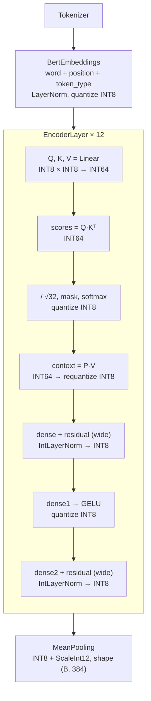

# Mô hình NumPy mô phỏng FPGA

Thư mục này mô phỏng cách FPGA tính sentence embedding của MiniLM
(`paraphrase-multilingual-MiniLM-L12-v2`, file `model/weights/model.onnx` bản float).
Mục tiêu là trên FPGA chỉ còn phép cộng, nhân, dịch bit, so sánh và tra LUT. Các phép khó
(chia, căn, `exp`, `erf`) phải được tính sẵn trên máy tính thành hằng số hoặc bảng LUT.

Hiện **LayerNorm trong encoder đã là số nguyên hoàn toàn**. Một số bước khác vẫn còn dùng
số thực, liệt kê ở mục [Phần còn dùng số thực](#phần-còn-dùng-số-thực).

## Quy ước

- **INT8 + `ScaleInt12`**: tensor `X` lưu dạng mã `x_q` (INT8, trong [−127, 127]) kèm scale
  `S`, với giá trị thực `X ≈ x_q · S`.
- **Q.F**: số nguyên `X` biểu diễn giá trị thực `X / 2^F`.
- **`bitlen(v)`**: số bit cần để biểu diễn `v >= 0` (bộ mã hoá ưu tiên), `bitlen(0) = 0`.
- **`>>`**: dịch phải số học (làm tròn xuống).
- **`round_shift(x, k)`**: dịch phải có làm tròn.
  - `k > 0`: `(x + 2^(k-1)) >> k`
  - `k = 0`: `x`
  - `k < 0`: `x << -k`
- **`check_bits(x, B)`**: báo `OverflowError` nếu `x` không vừa `B` bit có dấu. Hàm này mô
  phỏng độ rộng thanh ghi trên FPGA.
- `N = 384` (hidden size), `H = 12` head, `D = 32` chiều mỗi head.

## Luồng hoạt động



| Bước | File | Đầu vào → đầu ra |
|---|---|---|
| Embedding | `layers/bert_embedding.py` | token ID → INT8 + scale |
| Q/K/V, attention | `layers/self_attention.py` | INT8 → INT8 + scale |
| Attention output | `layers/attention_output.py` | `Linear` + residual + `IntLayerNorm` |
| Feed-forward | `layers/feed_forward.py` | `Linear` → GELU → `Linear` + residual + `IntLayerNorm` |
| LayerNorm | `layers/int_layer_norm.py` | accumulator INT64 + scale → INT8 + scale |
| Pooling | `layers/mean_pooling.py` | INT8 (B, N, 384) → INT8 (B, 384) |

`model.py` (`SentenceEmbeddingModel`) nối các bước trên. `main.py` đọc câu từ bàn phím,
chạy model và in trace của từng layer.

## 1. Scale `ScaleInt12` (`utils/scale_int12.py`)

Mỗi scale được biểu diễn bằng 12 bit:

```
S ≈ m · 2^(−n)        m: INT8 trong [0, 127],  n: UINT4 trong [0, 15]
đóng gói: bit [11:4] = m, bit [3:0] = n
```

`quantize_scale` chọn `n` lớn nhất sao cho `round(S · 2^n) ≤ 127`, để giữ nhiều bit nhất cho `m`.

- **Nhân hai scale (`*`)**: `m = m1 · m2`, `n = n1 + n2`. Sau đó chuẩn hoá lại về 12 bit
  (dịch phải có làm tròn, giảm `n` tương ứng).
- **Nhân giữ nguyên (`multiply_wide`)**: giữ `m1 · m2` và `n1 + n2` mà chưa làm tròn. Dùng cho
  scale của accumulator, để scale không bị làm tròn về 0 trước khi tính scale đầu ra.

## 2. Cách nhân trong `Linear` (`layers/linear.py`)

Weight trong ONNX có dạng `(in, out)`.

**Chuẩn bị (máy tính).** Lượng tử hoá đối xứng theo cả tensor:

```
S_W = ScaleInt12(max|W| / 127)
W_q = clip(rint(W / S_W), −127, 127)          INT8
```

**Tính (mỗi lần gọi).**

```
S_acc = S_X ⊗ S_W                        (multiply_wide: m_X · m_W, n_X + n_W)
b_q   = rint(b / S_acc)                  INT32, báo lỗi nếu tràn
acc   = Σ_k x_q[k] · W_q[k, j] + b_q[j]  INT8 × INT8, cộng dồn INT64
```

Phép nhân `x_q · W_q` là phần chạy trên systolic array.

**Requantize về INT8** (`utils/quantize.py`):

```
S_Y = ScaleInt12(max|acc| · S_acc / 127)
y_q = clip(rint(acc · S_acc / S_Y), −127, 127)
```

## 3. Cộng residual (`add_quantized`)

Hai tensor có scale `m_L · 2^(−n_L)` và `m_R · 2^(−n_R)` được đưa về cùng đơn vị `2^(−n)`
với `n = max(n_L, n_R)`:

```
f_L = m_L << (n − n_L)
f_R = m_R << (n − n_R)
acc = q_L · f_L + q_R · f_R              INT64, đơn vị 2^(−n)
```

Ở bản `wide=True` (dùng trước LayerNorm), `acc` được giữ nguyên và đưa thẳng vào
`IntLayerNorm`, không requantize về INT8 trước.

## 4. LayerNorm số nguyên (`layers/int_layer_norm.py`)

ONNX tính:

```
y_i = γ_i · (x_i − μ) / sqrt(σ² + ε) + β_i
μ   = (1/N) Σ x_j
σ²  = (1/N) Σ (x_j − μ)²,       ε = 1e-12
```

Đầu vào là `acc` INT64 từ `add_quantized`, với `x_i = acc_i · 2^(−n)`.

### Biến đổi để bỏ phép chia

Đặt `S = Σ x_j` và `d_i = N·x_i − S = N·(x_i − μ)`. Khi đó:

```
x_i − μ = d_i / N
σ²      = (1/N) Σ (d_j / N)² = ‖d‖² / N³
(x_i − μ) / σ = (d_i / N) · N^(3/2) / ‖d‖ = √N · d_i / ‖d‖
```

Vậy:

```
y_i = (γ_i · √N) · (d_i / ‖d‖) + β_i
```

- `N·x_i = (x_i << 8) + (x_i << 7)` vì `384 = 256 + 128`, nên chỉ cần dịch và cộng.
- `γ_i · √N` là hằng số, được tính sẵn trên máy tính. FPGA không cần biết `√N`.
- `d_i / ‖d‖` luôn nằm trong `[−1, 1]`, nên biểu diễn gọn được trong 18 bit.
- **Scale đầu vào bị triệt tiêu**: nhân mọi `x_i` với cùng `2^(−n)` thì `d / ‖d‖` không đổi.
  Vì vậy LayerNorm làm việc trực tiếp trên `acc` mà không cần biết scale.
- `ε = 1e-12` được bỏ qua vì rất nhỏ so với `σ²` thực tế.

### Chuẩn bị (trong `__init__`)

```
G_i = round(γ_i · √384 · 2^10)          Q.10, 18 bit có dấu
B_i = round(β_i · 2^16)                 Q.16
LUT = prepare_rsqrt_lut()               768 ô × 16 bit
```

`G` dùng Q.10 vì trên cả 25 LayerNorm của MiniLM có `max|γ| = 3.43` (ở attention.output
của layer 8), tức `max|γ·√384| ≈ 67.2`. Phần nguyên cần 7 bit, cộng bit dấu, nên còn 10 bit
cho phần lẻ: `|G| ≤ 68 767 < 2^17`.

### Tính trên FPGA (`normalize`)

**Bước 1: tổng và độ lệch.**

```
S   = Σ acc_j
d_i = N · acc_i − S
```

**Bước 2: dịch động theo từng vector.** Bình phương `d` trực tiếp sẽ quá rộng cho DSP.
Vì vậy `d` được dịch xuống còn 18 bit trước khi bình phương:

```
P   = max_i |d_i|
k   = max(bitlen(P) + 1 − 18, 0)
e_i = d_i >> k                          18 bit có dấu, |e_i| < 2^17
```

Vì mọi phần tử bị dịch cùng `k` bit, `e / ‖e‖ ≈ d / ‖d‖`. Mức dịch `k` được chọn riêng cho
từng vector, nên `e` luôn dùng đủ 18 bit dù độ rộng của `acc` thay đổi theo layer.

> Với mức dịch tĩnh theo trường hợp xấu nhất, `e` thực tế chỉ dùng khoảng 15 bit và sai số
> lớn hơn khoảng 10 lần. Đây là lý do chọn dịch động.

**Bước 3: tổng bình phương.**

```
Q = Σ e_i²                              ≤ 384 · 2^34 < 2^43, vừa accumulator 48 bit
```

**Bước 4: căn bậc 2 nghịch đảo**, xem mục 5.

```
1 / sqrt(Q) ≈ y · 2^(−s)
```

**Bước 5: chuẩn hoá.**

```
n_i = round_shift(e_i · y, s − 17)      ≈ e_i / ‖e‖, dạng Q.17
n_i = clip(n_i, −(2^17 − 1), 2^17 − 1)
```

`n_i` bị bão hoà vì `|e_i| / ‖e‖` có thể bằng đúng 1.0 khi vector chỉ có một phần tử
khác 0, mà 1.0 trong Q.17 là `2^17`, không vừa 18 bit có dấu.

Nếu `Q = 0` (mọi phần tử bằng nhau) thì đặt `n_i = 0`, và đầu ra chỉ còn `B_i`.

**Bước 6: gamma và beta.**

```
out_i = round_shift(n_i · G_i, 17 + 10 − 16) + B_i
      = round_shift(n_i · G_i, 11) + B_i            Q.16, INT32
```

Kiểm tra định dạng: `n_i · G_i` có `17 + 10 = 27` bit phần lẻ, dịch đi 11 bit còn 16 bit
phần lẻ, cùng định dạng với `B_i`. Vì `|out| ≤ 67.2 + 1.82`, kết quả vừa 24 bit có dấu.

**Bước 7: về INT8.** `__call__` đưa `out` (đơn vị `2^(−16)`) qua `requantize` giống
`Linear`, cho ra INT8 + `ScaleInt12`.

## 5. Căn bậc 2 nghịch đảo (`utils/rsqrt.py`)

Mục tiêu: với số nguyên dương `v` (tới khoảng 2^47), tìm `y`, `s` sao cho
`1/sqrt(v) ≈ y · 2^(−s)`.

### Chuẩn hoá

Viết `v = m · 2^E` với `E` chẵn và `m ∈ [1, 4)`. `E` phải chẵn để `sqrt(2^E) = 2^(E/2)`
là số nguyên.

```
p = bitlen(v) − 1                       vị trí bit 1 cao nhất
E = p & ~1                              làm tròn xuống số chẵn
m = v >> (E − 16)    (hoặc v << (16 − E) nếu E < 16)
                                        m ∈ [2^16, 2^18), tức [1, 4) dạng Q.16
```

### Tra LUT

Khoảng `[1, 4)` được chia thành các ô rộng `2^−8`, tổng cộng `3 · 256 = 768` ô:

```
idx    = (m >> 8) − 256                 trong [0, 767]
LUT[i] = round(2^16 / sqrt(1 + (i + 0.5) / 256))      lấy tại tâm ô
y0     = LUT[idx]                       Q.16, trong [32776, 65472], vừa 16 bit không dấu
```

LUT có 768 ô × 16 bit, vừa một BRAM18. Riêng LUT cho sai số tương đối khoảng 1e-3.

### Một bước Newton

Giải `f(y) = 1/y² − m = 0` bằng Newton:

```
y1 = y0 · (3 − m · y0²) / 2
```

Ở dạng số nguyên Q.16:

```
y²  = (y0 · y0) >> 16
t   = (m · y²) >> 16                    ≈ 1.0, dạng Q.16
y1  = (y0 · ((3 << 16) − t)) >> 17
```

Newton hội tụ bậc hai, nên sai số giảm từ khoảng 1e-3 xuống mức giới hạn bởi làm tròn
16 bit. Đo được: **sai số tương đối lớn nhất 3.6e-5** trên `v` từ 1 đến 2^47.

### Kết quả

```
1 / sqrt(v) = (y1 / 2^16) · 2^(−E/2)  ⇒  y = y1,  s = 16 + E/2
```

## Độ rộng bit và số phép nhân của LayerNorm

| Tín hiệu | Định dạng | Độ rộng |
|---|---|---|
| `e` | – | 18 bit có dấu |
| `Q = Σe²` | – | ≤ 43 bit (accumulator 48 bit) |
| `y` (rsqrt) | Q.16 | 16 bit không dấu |
| `n` | Q.17 | 18 bit có dấu |
| `G` | Q.10 | 18 bit có dấu |
| `B`, `out` | Q.16 | ≤ 24 bit có dấu (lưu INT32) |

`d` có độ rộng bằng độ rộng của `acc` cộng thêm 10 bit (vì `|d| ≤ 2N · max|acc|`).

Số phép nhân cho mỗi token:

| Bước | Phép nhân | Kích thước |
|---|---|---|
| `N · acc` | 0 (dịch + cộng) | – |
| `e_i²` | 384 | 18 × 18 bit |
| rsqrt (Newton) | 3 | ≤ 18 × 16 bit |
| `e_i · y` | 384 | 18 × 16 bit |
| `n_i · G_i` | 384 | 18 × 18 bit |

Mọi phép nhân đều vừa DSP48E2 (27 × 18).

### Độ chính xác

So với công thức float64 mà `IntLayerNorm` dùng trước đây, trên gamma/beta thật của cả 25
LayerNorm, với đầu vào giống residual (accumulator ở đơn vị `2^−14`, `2^−20`, `2^−26`, có
3 chiều outlier lớn gấp 30 lần):

| Đại lượng | Giá trị |
|---|---|
| Sai số tuyệt đối lớn nhất (trước INT8) | 9.5e-4 |
| Sai số tuyệt đối trung bình | 7.9e-5 |
| Cosine nhỏ nhất | 0.99999996 |
| Chênh lệch sau khi về INT8 | ≤ 1 LSB |

Nguồn sai số chính:

- Bỏ bit thấp khi dịch `d` thành `e` (bước 2).
- Độ phân giải Q.17 của `n` nhân với `G` (tới khoảng 67).
- Sai số rsqrt (3.6e-5 tương đối).

## Phần còn dùng số thực

Các bước sau vẫn dùng float trong mô phỏng, cần thay bằng LUT hoặc phép tính số nguyên
trước khi đưa xuống FPGA:

| Bước | File | Phép float |
|---|---|---|
| Embedding | `layers/bert_embedding.py` | tra bảng float32, `LayerNorm` float (`layers/layer_norm.py`) |
| Scores | `layers/self_attention.py` | dequantize, chia `√32` |
| Softmax | `utils/softmax.py` | `exp`, chia |
| GELU | `layers/feed_forward.py` | `erf` |
| Scale đầu ra | `utils/quantize.py` | `max|acc| · S / 127`, `rint(acc · S_acc / S_Y)` |
| Pooling | `layers/mean_pooling.py` | chia cho số token |

## Chạy thử

Chạy model cần file `model/weights/model.onnx` (thư mục `weights/` bị `.gitignore` bỏ qua):

```bash
python model/numpy/main.py
```

Test LayerNorm không cần file weights, vì dùng gamma/beta tổng hợp trong cùng khoảng giá
trị với model thật:

```bash
python -m unittest model.test_numpy_model -v
```

Test kiểm tra:

- `normalize` khớp công thức float64 (sai số lớn nhất < 2e-3, trung bình < 2e-4,
  cosine > 0.99999).
- Đầu ra INT8 lệch không quá 1 LSB so với bản float64.
- Sai số tương đối của rsqrt < 1e-4.
- Vector hằng cho đầu ra bằng beta.
